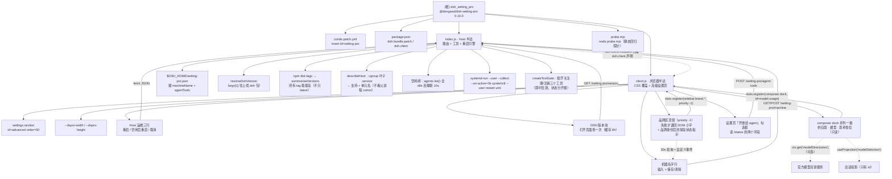

[根目录](./AGENTS.md) > **dsh_setting_pro**

# AGENTS.md

给在这个仓库里干活的 agent 看的：**架构地图、硬约束、命令与改动连带项**。面向用户的用法、安装与
验证清单在 [README.md](README.md)。文档分工与兄弟仓库（`dsh_editor` / `dsh_sidebar_terminal` /
`gitea_task_issues`）一致：

| 想知道 | 看 |
| --- | --- |
| 怎么用（装 / 用 / 协议 / 排错 / 验证 / 边界） | [README.md](README.md) |
| 为什么这么实现（取舍、一次调用的路径） | [IMPLEMENTATION.md](IMPLEMENTATION.md) |
| 给 agent 的约束与连带项 | 本文件 |

## 项目愿景

一个包四件事，前三样都挂在「设置 → 高级设置」这一页：

1. 把 DSH Web 的**设置弹窗**从官方写死的 `800 × 800` 放大（开箱 `1180 × 920`）；
2. 提供**重启 dsh** 与**空闲后重启 dsh**，让 Host 半边插件的改动不必离开界面就能生效；
3. 在界面上补三处官方没有的**只读信息**：左上角常驻状态指示（忙/空闲 + 悬停明细）、
   机器名字顶替品牌区、以及输入框下方「性能与用量」那一行旁边的**「供应商 · 模型 · 思考档位」**；
4. 让运维入口**可关**：这三个重启工具能不能被模型看到，是设置页上的一个勾选框（即时生效、状态文件持久）。

定位仍是「小、自足、不碰官方私有面」：单包、零依赖、无构建；尺寸与显示开关只存在本机浏览器，
重启只交给 systemd，不自己接管进程；**加信息不改官方行为**（官方那两条 pill、那个模型下拉、
那个品牌区都在原处，能并列就并列、要顶替只用官方给的 priority 机制、失败就退回不画）。

## 架构总览

| 半边 | 文件 | 干什么 |
| --- | --- | --- |
| Host | [index.js](index.js) | 七条 HTTP 路由（status/restart/schedule/cancel/version/machine/agent-tools）+ 三个模型工具（带**网关注册/注销**） + 重启引擎：用 **cgroup 叶子**判定宿主与单元名、空闲闸、把重启交给游离的 systemd 临时单元；状态里带 `startedAt`/`uptimeMs`/`dshVersion`/`machineName`/`runningSessions`（标题按 sessionId 缓存 30s，因为 `sessionTitle.get` 每次折全量事件）；版本检查查 npm dist-tags（缓存 6h）；机器名字与「开放给 agent」开关落 `$DSH_HOME/setting-pro.json`（一个文件两个键，共用同一套合并写） |
| 浏览器 | [client.js](client.js) | 注入覆盖面板几何的 CSS、注册 `settings.section` 页（尺寸三行 + 「Host 运维」三行 + 「机器名字」行 + 「输入框下方那一行」开关 + 「DSH 版本」块）、轮询 Host 状态、打开页面即查一次版本、忙时二次确认、重连后按 `bootId` 判断「重启完成」、用**槽位 `priority: -1` 顶掉官方品牌区**显示机器名（顶不掉才退回 DOM 小字）、在品牌身份后面挂**常驻状态指示**（忙：`运行中 ×N` + 悬停「工作区 · 会话标题」；空闲：灰色 `空闲`），并在 `conversation.composer.dock`（list 槽）**并列**加一格只读的 `供应商 · 模型 · 思考档位`（数据来自可选服务 `modelDirectories`，退路是会话投影 `modelSelection`，那时显示内部 id 并如实说明） |
| 装配 | [cordis.patch.yml](cordis.patch.yml) / [package.json](package.json) | patch 插入条目 `id: setting-pro`；`dsh.bundle.patch` 指向 patch，`dsh.client` 声明 `platform` / `immediately` / `inject` |
| 探针 | [probe.mjs](probe.mjs) | `node probe.mjs`：纯逻辑 + 路由/工具契约 + 版本比较/更新检查（假 fetch、假时钟）+ 机器名清洗与存取（假 fs）+ 浏览器组件假渲染 + **品牌区顶替与 DOM 兜底两条路**（假槽位/假 DOM）+ **状态指示**（假 /status + 手动触发轮询：忙/空闲两态与悬停明细）+ **模型格**（三段拼法与 id 退路、开关落盘与关掉后不渲染、挂不上时异常不外抛）+ **重启工具网关**（即时注册/注销、两个字段分开报）+ 产物形状，共 334 项；**不会真的重启、不出网、不写真实状态文件** |

浏览器半边仍由 `@deepseek-ai/dsh-client-modules` 扫描 Host loader 条目、挑出声明了 `dsh.client` 的包后送进浏览器 ——
`index.js` 里 `export const inject` / `apply` 的**存在本身**就是那条 loader 条目。

### 模块结构图

### 模块索引

本仓库是**单模块扁平结构**（8 个文件、无子目录），包根即唯一模块，因此模块级文档由本文件兼任，
不再嵌套第二份 `AGENTS.md`。

| 模块路径 | 语言 | 一句话职责 | 文档 |
| --- | --- | --- | --- |
| `.`（包根，单模块） | JS（Host 侧 ESM；浏览器侧 `__ModuleLoader__` factory-CJS bundle） | 设置弹窗尺寸 + Host 重启入口 | [AGENTS.md](./AGENTS.md)（本文件） |

文件级导航：

| 文件 | 角色 | 关键锚点 |
| --- | --- | --- |
| [index.js](index.js) | Host 半边 | `parseServiceUnit` / `resolveUnit` / `describeHost`（**能不能重启的判据**）/ `detectSupervisor`（仅展示用）/ `restartUnitArgv` / `createIdleWatch` / `formatDuration` / `parseVersion` / `compareVersions` / `resolveDshVersion` / `summariseVersions` / `createVersionChecker` / `stateFilePath` / `sanitizeMachineName` / `createMachineStore` / **`describeRunningSession`**（纯函数，探针直接测）、`runningSessions()`（`basename(header.cwd)` + 可选 `sessionTitle` + `TITLE_TTL_MS` 缓存）、`createRestartControl`（可注入 `machine` store，探针用假 fs）、`registerRoutes`、**`createToolGate`（网关注册/注销 + 实时视图）**、**`describeAgentTools`**（纯函数）、`registerTools`（改收 `register` 回调）、`inject`、`apply` |
| [client.js](client.js) | 浏览器半边 | `PANEL_SELECTOR`、`DEFAULTS`/`LIMITS`/`STEP`、`PANEL_CSS`、`PAGE_CSS`、`DICT`、`panelRow`、`opsPost`、`opsSummary`、`formatUptime`/`formatStartedAt`/`formatTags`、`fetchVersion`/`fetchMachine`、`HostOps`、`MachineNameBlock`、`VersionBlock`、**`MachineBrandMark`/`MachineBrandName`（品牌区顶替）、`startBrandReplacement`（priority -1 占位/撤销）、`startMachineNameSource`（名字来源）、`startBrandExtras`（DOM 兜底行 + 运行指示）、`startBusySource`/`busyStore`（状态源，含 `known`「未知不画」）、`runningHoverText`/`signatureOf`、`fetchStatus`**、`useMachineName`、**`describeModelState`/`selectionOfProjection`（纯函数，探针直接测）、`modelPillStore`（开关 + localStorage）、`createModelStoreResolver`（带缓存的可选服务解析）、`mountModelPill`（list 槽并列注册 + 回调内 try）、`ModelUsagePill`/`ModelPillBlock`**、**`agentToolsSummary`/`agentToolsClass`（「开放给 agent」那行的文案与配色）**、`AdvancedSection`、`apply`、`probe`（仅给探针的纯件导出） |
| [probe.mjs](probe.mjs) | 静态回归探针 | **334 项 / 16 类**，写在 15 个 `#region` 区块里（`grep -c '^// #region' probe.mjs` → 15）：cgroup 解析、supervisor 探测、单元优先级、命令构造、空闲状态机、产物形状、路由/工具契约、浏览器组件假渲染（含**品牌区顶替与 DOM 兜底两条路**、**状态指示两态与悬停明细**）、宿主判据（describeHost）、最后启动时间、版本比较与更新检查（假 fetch/假时钟）、机器名字（假 fs）、**重启工具网关**（即时注册/注销、两个字段分开报）、**模型格**（三段拼法与内部 id 退路、开关落盘、注册抛错不外抛） |
| [IMPLEMENTATION.md](IMPLEMENTATION.md) | 设计取舍 | 为什么用两个属性选择器覆盖几何、为什么不自己拉起进程、npx 判据坑、为什么看所有 dist-tag、为什么机器名用槽位 priority、那一行为什么并列而不顶替官方选择器、工具开关为什么能即时生效、一次「点重启」的完整路径 |
| [cordis.patch.yml](cordis.patch.yml) | bundle patch | `insert: [{id: setting-pro, name: '@dongasai/dsh-setting-pro'}]` |
| [package.json](package.json) | manifest | `dsh.bundle.patch`、`dsh.client.{platform,immediately,inject}` |
| [README.md](README.md) | 用户文档 | **怎么用**：开篇立论、功能表、三种装法与坑、界面逐块走查（含那一行的位置与悬停）、生效条件两半、结构（含扩展点占用表）、线上协议（7 路由 / 9 错误码）、安全模型、与 Agent 的关系、排错表、验证（命令行 + 浏览器打勾）、已知边界 |

## 运行与开发

安装方式是 profile 的 `link:`（`~/.dsh/profiles/web/package.json` 记
`"@dongasai/dsh-setting-pro": "link:/data/ai/dsh/dsh_setting_pro"`，`node_modules/@dongasai/dsh-setting-pro`
软链回本目录），本插件**已是已装状态**。

| 目的 | 命令 |
| --- | --- |
| 静态回归探针（先跑这个） | `node probe.mjs` |
| 语法自检（两半都跑） | `node --check index.js && node --check client.js` |
| 校验 manifest | `python3 -c "import json;json.load(open('package.json'))"` |
| 校验 patch | `python3 -c "import yaml,json;print(json.dumps(yaml.safe_load(open('cordis.patch.yml')),ensure_ascii=False))"` |
| 看 Host 状态（需新 Host 半边已加载） | `curl -s http://127.0.0.1:3080/setting-pro/status` |
| 装进 profile（换机器/重装才用） | `dsh plugin --profile web add /data/ai/dsh/dsh_setting_pro` |
| 确认在 profile 名单里 | `grep -n setting-pro ~/.dsh/profiles/web/package.json` |
| 确认 link 落地 | `ls -l ~/.dsh/profiles/web/node_modules/@dongasai/` |
| 看装配结果 | `dsh --profile web --dump-config \| grep -A2 setting-pro`（⚠️ 见下） |

⚠️ **`--dump-config` 不能在 agent 沙箱里跑**：装配前会写 profile 根文件
`~/.dsh/profiles/web/cordis.yml`，在 `workspace-write` 沙箱下必然
`Error: EROFS: read-only file system, open '.../cordis.yml'`（2026-10-16 本机实测）。要在**宿主 shell** 里跑；
沙箱内请用上面两条只读检查（profile 名单 + node_modules 软链）替代。

**改哪一半、怎么生效**：

| 改了什么 | 生效方式 |
| --- | --- |
| `client.js` | **刷新浏览器页面**（已物化的旧模块不会自己换掉） |
| `index.js` | **重启 dsh**（loader 是裸 `import()`，不击穿 ESM 缓存；重装 bundle 也不换模块） |
| `package.json` 的 `dsh.*` / `cordis.patch.yml` | profile 重新组装（GUI 安装实测当前进程热生效） |
| 界面上的尺寸 / 排程状态 | 即时生效；尺寸只写 `localStorage` |

⚠️ **鸡生蛋**：0.3.0 的 Host 半边是**新加**的。从 0.2.0 升上来的那个进程里只有空 `apply`，
所以「重启 DSH」按钮要等**第一次重启之后**才存在 —— 第一次必须由宿主执行
（`systemctl --user restart dsh`，或在 GUI 重装 bundle 后重启）。此后自举闭环成立。

## 测试策略

**没有前端测试环境，也没有真的重启可以在仓库里跑通**：能自动验的只有宿主侧纯逻辑与契约，
那正是 `probe.mjs` 覆盖的 **16 类**（334 项），分布在 15 个 `#region` 区块里
（`grep -c '^// #region' probe.mjs` → 15，其中第 8 块之后紧跟一块 `8b`）。**类号与区块号不是一一对应**：
第 13、14 类（左上角、状态指示）的断言就写在第 8 块内部，末尾两块（区块 13、14）分别是第 15、16 类。

1. `parseServiceUnit`：真实 cgroup 行 → `dsh.service`；叶子是 scope → `null`（**绝不回退到 user@1000.service**）；
2. `detectSupervisor`：标记 + 父进程 `systemd` 才算（**这条只用于展示**，不是重启判据）；
3. `resolveUnit`：env 覆盖 → cgroup → 兜底三级优先级；
4. `restartUnitArgv`：`systemd-run` 参数逐条比对（`--user`、`--collect`、`--on-active=3s`、目标单元在末尾）；
5. `createIdleWatch`：注入时钟驱动，繁忙清零、差 1ms 不开火、满窗开火且只开一次、取消即失效；
6. 路由与工具契约（**假 ctx**，不碰真实 systemd）：七条路由注册、三个工具的形状、信任围栏 403、
   非 GET/POST 405、非 JSON 400、坏 JSON 400、忙且未 force 409、非 systemd 主机 501；
7. 产物形状：`index.js` 只 import `node:` 内建、没有「立即重启」工具、`client.js` 仍注册 `settings.section`、
   `package.json` 的 `dsh.client` 声明未变；浏览器侧还静态断言「排程按钮不再被 `!supported` 禁用」
   「非 JSON 响应带 `missing` 标记（不给假回执）」；
8. 浏览器半边冒烟（假 `window` + 假 React）：加载 `client.js` 拿到 factory、`inject` 只有 `slots`/`locale`、
   `settings.section` 注册为 `advanced`/50/label 是 thunk、zh 与 en 键完全一致，
   并把 `AdvancedSection` → `HostOps` 真的调一遍，断言渲染文本里有「Host 运维」三行且没有缺失的字典键；
   再把源码里**所有** `t('key')` 抽出来核对两本字典都有该键；
9. `describeHost`（宿主判据）：真实 `dsh.service` cgroup → 支持（**父进程是 npx 也算**）、
   env 覆盖优先、叶子是 scope / 读不到 `/proc` / 叶子是 `user@1000.service` / 缺 systemd 标记 → 都不支持且给原因；
10. 最后启动时间：`status.startedAt + uptimeMs ≈ now`、`formatDuration` 四档渲染、工具输出含 `startedAt` 与 `(up …)`；
11. 版本与更新检查：`parseVersion`/`compareVersions`（预发布优先规则、坏数据返回 null）、
    `resolveDshVersion`（env 覆盖 / 从 `argv[1]` 找到 dsh 包 / nearest / none）、
    `summariseVersions`（**所有** dist-tag 取最高，不只 latest；给同线 tag 的 `line`）、
    `createVersionChecker`（假 fetch + 假时钟：首次查、TTL 内缓存、过期重查、`refresh` 强制、
    失败记 `error`、一次抖动不抹掉上次成功结论），以及 `/setting-pro/version` 路由契约
    （200 + `error` 字段、非 GET 405）；
12. 机器名字：`sanitizeMachineName`（去空白 / 控制字符换空格 / 折叠 / 截断 64 / 非字符串 → null）、
    `stateFilePath`（跟随 `DSH_HOME`，缺省 `~/.dsh`）、`createMachineStore`（**假 fs**：文件不存在＝空名、
    写入走 tmp+rename、保留同文件其它键、坏 JSON 与类型不符退回空名并记 error、写失败返回 `write-failed` 不抛），
    以及 `/setting-pro/machine` 路由契约（GET 200 / 非字符串 name → 400 / 坏 JSON 400 / PUT 405）；
13. 左上角显示（**两条路都测**，用假槽位 + 假 DOM + 假 MutationObserver）：
    ① 顶替：有名字时 `sidebar.brand.mark` / `sidebar.brand.name` 各注册一次且 `priority: -1`，
    正文组件渲染出名字、标记组件渲染 `null`，此时**不**画 DOM 兜底（避免重复）；清空名字后两个占位都被卸载；
    ② 兜底：让品牌注册抛错（模拟占位失败），名字应退回「品牌行之后」的小字 ——
    含**回归断言「logo 行里有 button 也要能命中」**（2026-10-17 的 bug）、不插到 topStrip、
    名字只走 `textContent`、改名即时更新、卸载后撤节点；
14. 状态指示（常显两态）：假 `/status` 报 `busy:true, runningCount:2` → 手动触发 5s 轮询 → 品牌身份**之后**
    出现 `.dspro_run`，文案 `运行中 ×2`（走 `textContent`）；带 `runningSessions` 时悬停拼出多行
    「工作区 · 会话标题」（缺标题只显示工作区），且**计数没变、只有标题变**时也要跟上（验 `signatureOf`）；
    报空闲时**不撤掉**，切成 `data-state="idle"` + 灰色 `空闲`；**第一次成功读到之前不画**（`known`）。
    Host 侧另验 `describeRunningSession` 五种拼法、`runningSessions` 带 cwd/标题、agent 无 session 时留空不抛；
15. **重启工具网关**（是否开放给 agent）：`describeAgentTools` 五种组合（开+已注册 / 关+未注册 / 网关没挂上=未知 /
    开了没挂上 / 关着却还挂着 —— 后两种都必须写「不一致」并带原因）；`createMachineStore` 的**一个文件两个键**
    （改名字不抹开关、改开关不抹名字、落盘 JSON 两键都在；`agentTools` 非布尔按缺省=开并记 error、
    `writeAgentTools` 非布尔 → `bad-request`）；用**假 fs + 假 ctx** 走完整闭环 —— `sync()` 注册三个、
    `setAgentTools(false)` 之后工具表**真的空了**、再开又回来、重复 `sync()` 不重复注册、`dispose()` 收干净；
    `/setting-pro/agent-tools` 契约（GET 带 `enabled/exposed/names`、POST false/true 都改变实际注册、
    非布尔 400、非 GET/POST 405）；`apply` 层面用**临时 `DSH_HOME`**（仓库里的 `.probe-tmp`，用完删）验
    「文件里是关 → **一个工具都不注册**」与「没这个键 → 按缺省注册三个」；以及**注册抛错不把插件带崩**
    （撞名 → `apply` 不抛、状态里 `agentTools:true` 但 `agentToolsExposed:false` 且带原因 —— 不许抹平成一致）；
    客户端 `agentToolsSummary`/`agentToolsClass` 同样分开报（未知 ≠ 未开放），并静态钉住
    「复选框 `checked` 读 `/status` 的 `agentTools`」+「改动走 POST」+ 两半 URL 字面一致；
16. 模型格（`conversation.composer.dock` 那一格）：`describeModelState` 的六种输入 —— 目录命中（三段
    「供应商 · 模型 · 档位」+ 悬停三行带内部 id）、`deepseek-account` 用本地化供应商名、未选档位落目录默认档、
    目录里没有的档位 id 原样显示、无 reasoning 用 `retainedEffort` 并说明「没有可选档位」、
    目录不可用退到投影（显示 `provider/model`、`usingIds: true`、悬停说明来源），以及**什么都不知道时返回 null（不画）**；
    挂载形状用假槽位验 `id: model-usage`（**不是** 复用官方 `stats`）、`order: 1`、**不带 `priority`**（并列而非顶替）；
    渲染两条路：无 `modelDirectories` 服务时用投影出内部 id、`directoryFor` 抛错时不炸仍退回投影、目录可用时出可读名；
    开关验「关掉 → localStorage `'0'` → 那一格**真的不渲染**」、「重新物化模块时默认值真的读 localStorage」；
    **错误隔离**：用「先不跑回调、声明时才跑」的假 `inject` 让注册抛错，断言异常**没有**冒回槽位通知循环
    （官方 `notifyDeclaration`/`flush` 是裸循环，不隔离异常），并记下真实原因给设置页看。

**探针刻意不触发真实重启**：只有本进程不在 systemd 服务里时才测「force 也会被 501 拒绝」那条；
在真服务里跑探针同样安全（排程后立刻取消并 dispose）。

命令行证明不了的部分，照 README 的清单在界面上核：尺寸三条 + 「Host 运维」五条
（点重启会真的重启，需你本人点）+ 状态指示四条 + 机器名字三条 + 那一行的模型格四条
（官方两条仍在、悬停三行、改模型后跟上、开关关掉即消失）+ DSH 版本两条。

## 编码规范

- **单文件、无构建、零依赖**：两侧都不会经打包器。不要写需要编译/打包的语法；
  Host 侧解析不到裸包名 `@deepseek-ai/*`，`Config` 也不要导出（要 schemastery）。
- 命名前缀固定：CSS 类 `dspro_*`、CSS 变量 `--dspro-*`、localStorage 键 `dsh.setting-pro.*`、
  路由前缀 `/setting-pro/`、工具名 `dsh_restart_*`、样式表 id `@dongasai/dsh-setting-pro/panel-size.css`。
- **颜色 / 圆角 / 边框一律走主题 token**（`--dsw-alias-*`、`--dsw-radius-*`），错误文本用
  `--dsw-alias-state-error-primary`，不写死色值。
- 用户可见文案全部进 `DICT`，**zh / en 两份必须同时改**（探针会比对键数一致）。
- 数值入口统一走 `clamp(axis, value)`；Host 侧所有对外字段集中在 `control.status()` 一处，
  路由与工具共用同一份快照。
- 注释与提交信息用中文；提交格式 `类型(范围): 说明`：`功能(...)` / `修复(...)` / `文档(...)` / `重构(...)` / `发布(...)`。

## 硬性约束（违反即出 bug，别试探）

1. **重启必须走游离的 systemd 临时单元**（`systemd-run --user --collect --on-active=...`）。
   `dsh.service` 是 `KillMode=control-group`：在本进程里 `spawn` 的任何 detached helper 仍在同一 cgroup，
   重启时被一起回收。`dshmarket` 的自我重启因此在 systemd 下默认关闭（它自己的文案：
   「重启会连带杀掉 cgroup 里的接管进程，服务将起不来」）。**不要退化成自重启。**
2. **`--on-active` 的延迟（3s）不能省**：`systemctl restart` 一到就把宿主停掉，HTTP 应答回不到浏览器，
   用户只看到页面直接断。
3. **能不能重启看 cgroup 叶子，不看父进程 comm。** `ExecStart=npx -y @deepseek-ai/dsh web` 时，
   真正跑 dsh 的 node 进程父进程是 `npx`：用「父进程是不是 systemd」判会把正常服务误判成无人托管
   （dshmarket 那条判据在这里踩坑，本机 2026-10-17 实测 `_SYSTEMD_CGROUP=…/app.slice/dsh.service`、
   `_SYSTEMD_USER_UNIT=dsh.service`、父进程 npx）。判不出就明确报 `unsupported-host` 并给出原因，
   不做猜测性降级；`detectSupervisor()` 只用于状态行展示「父进程是不是 manager」。
4. **单元名只取 `/proc/self/cgroup` 的叶子 `.service`**；叶子不是 `.service` 时走
   `DSH_SETTING_PRO_UNIT` → `dsh` 兜底。**绝不向上回退**到 `user@1000.service`（那会杀掉整个用户会话）。
5. **排程开火前那一刻必须重新复查** `ctx.agents.list()`；繁忙就把静默窗清零。静默窗 10s、复查间隔 2s
   是两个独立常量，别把「上一次的结论」当成本次依据。
6. **只 import `node:` 内建模块**；七条路由必须过 `ctx.connection.requestRejection(req)` 信任围栏，
   且只接受 `application/json`（跨源要预检，等于多一道闸）。
7. **刻意不给模型「立即重启」工具**：那会杀掉模型自己正在跑的回合，没有回合能在自杀后回报结果。
   立即重启只由人在 GUI 上点，忙时二次确认后带 `force: true`。
8. **不要让「等待重启」阻塞请求**：`fire()` 只把临时单元交给 systemd 并等 ~150ms 让 `ENOENT` 露头，
   然后立刻返回；真正的重启由 systemd 在那个单元里做。
9. **localStorage 键与默认值是对外契约**（三个）：尺寸 `dsh.setting-pro.size`（默认 1180×920、宽 640–2400 /
   高 480–1600、步进 20），重连判定 `dsh.setting-pro.pending-restart`（存发起前的 `bootId`），
   模型格开关 `dsh.setting-pro.modelPill`（缺省＝开，关掉写 `'0'`）。
   改键 = 用户已有偏好/判定失效，README 表格要同步。⚠️ 探针里的假 `window` 必须**真的**实现 localStorage：
   早先它引用了一个未声明的 `storage`，于是所有走 localStorage 的分支都被 try/catch 静默吞掉、等于没测（2026-10-17 发现）。
10. **`client.js` 的 POST 必须带 `content-type: application/json`**，否则被 Host 侧 400 挡掉；
    错误分支要区分 `status === 0`（Host 不可达，页面可能正在重连）与 HTTP 4xx/5xx。
11. **只改面板外框尺寸**：不动左侧导航宽度（官方 `188px`）、不动内容内边距、不给面板加新布局。
12. **界面按钮不因「不确定」灰掉**：「重启 DSH」「空闲后重启」始终可点，点下去由 Host 用真实原因回答
    （未加载 / 不支持 / 忙 / 已排程）。用户明确要求过这一点（2026-10-17：「空闲重启不可点，应该可点」）；
    只有「取消排程」在没排程时禁用。禁用态是「没有反馈的失败」，别用它代替说明。
13. **非 JSON 响应绝不当成功**：路由不存在时 SPA 兜底会回 `200 text/html`（实测，不是 404）。
    `client.js` 的 `opsPost`/`refresh` 必须以 `content-type` 判定，并把它标成 `missing`；
    否则会给用户「已发起重启」的假回执，然后什么都没发生。
14. **排程是幂等的**：重复点「空闲后重启」不得重置 10 秒静默窗（Host 侧 `already: true` 直接返回），
    否则用户每点一次就把重启往后推一次。
15. **更新检查必须看所有 dist-tag，不能只看 `latest`**：本机当前 `0.2.0-rc.2`、`latest` 也是
    `0.2.0-rc.2`，但 `alpha` 已是 `0.2.1-alpha.5` —— 只看 `latest` 会报「已是最新」，把用户所在那条线
    的新版本吞掉（dshmarket 的 `src/updates.ts` 在 #867 记过同一个坑）。比较用 semver 规则
    （正式版 > 预发布、数字段按数值比），**解析不出就返回 null 并显示「无法比较」，不装作相等**。
16. **更新检查不得阻塞、不得抹掉已有结论**：状态里的当前版本是本地读文件（不依赖网络）；
    registry 查询失败只记 `error` 并保留上一次成功的 dist-tags，绝不因为一次网络抖动把「有新版本」
    变成「已是最新」。查询走轻量端点 `/-/package/@deepseek-ai/dsh/dist-tags`，缓存 6h。
17. **只提示，不代劳升级**：不下载、不切通道、不改 profile、不替用户决定装哪个 tag。
18. **顶掉官方品牌区用槽位 `priority`，不要抢 DOM**。`sidebar.brand.mark` / `sidebar.brand.name` 都是
    `kind: "single"`，官方 `dsh-client-ui-brand-official` 用默认 priority 0 占着；**同一 priority 重复注册
    才抛错**，而投影按 priority 升序取第一个（`lowest renders`）—— 所以 `priority: -1` 就是官方认可的
    「顶掉它」。注册前必须等槽位被声明（用 `ctx.slots.inject`），否则抛 `slot … is not declared`。
    **只在有名字时占位**（没名字要能退回官方 logo，别静态占位再渲染 null，那会把 logo 弄没）。
19. **DOM 只是兜底**：万一槽位占位失败（`machineBrandState.mode === 'dom'`），才退回「logo 行下面一行小字」。
    那时锚点用**类名后缀** `[class*="_logoRow"]`（官方 CSS Modules 是 `<hash>_logoRow`，哈希会变、本地名稳定），
    再退到 `[data-window-drag]` 里含 `[class*="_brandIdentity"]` 的。
    ⚠️ 2026-10-17 的 bug：早先判据里加了「不含 button」，而 **logo 行里就有收起/展开按钮**，等于把自己排除了，
    于是永远找不到锚点、用户「配了名字却没出现」。**别再按有没有 button 筛。** 找不到锚点静默不显示、不抛错。
20. **机器名只走 `textContent`**：用户输入绝不进 `innerHTML`（不给自己开 XSS 口子）；Host 侧先剥控制字符/换行、
    折叠空白、截断 64 字。名字是**全机共享**的（一个 `$DSH_HOME` 一份），不是每浏览器一份。
21. **状态指示必须用 Host 口径，不要改成读官方 DOM**：orca 皮肤读 `[data-state='running']` /
    `[data-phase]` 是对的（它只需反映**当前挂载**的会话），但这个指示要和「空闲后重启」说同一件事 ——
    子代理、AgentTeams 成员、其它会话在跑时都得亮。所以读 `/status` 的 `busy`/`runningCount`
    （`ctx.agents.list()` 里 `status === 'running'` 的个数），5s 轮询，拿不到时**保持上一次结论**（不闪）。
    明细（0.8.0）：`/status` 新增 `runningSessions: [{sessionId, workspace, title}]`，
    `running: string[]` 原契约别动、只加字段。`workspace` = `basename(header.cwd)`（官方
    `defaultWorkspaceTitle` 同款算法），`title` 取**可选**服务 `sessionTitle` —— 取不到就留空，不猜标题；
    且标题按 sessionId 缓存 30s（`sessionTitle.get` 每次折全量事件，两路轮询不能每次全折）。
    **没成功读到过状态时不画**（`busyStore.known`：未知 ≠ 空闲，画个「空闲」就是假回执）。
22. **状态文件写入必须原子**：`$DSH_HOME/setting-pro.json` 走「临时文件 + rename」，并保留同文件里的其它键；
    读不到/坏 JSON 退回空名字并记 `error`，**不要**因为读失败就把文件覆盖掉。
23. **那一行的模型格是「并列」不是「顶替」**：`conversation.composer.dock` 是 **list 槽**（官方占用 `id: stats`、
    `order: 0`），list 槽只在**同一 id 且同一 priority** 才冲突 —— 所以必须用**我们自己的 `id`**（`model-usage`）
    和一个**大于 0 的 `order`** 排到官方那条右边，**别复用 `stats`**（复用就等于换掉官方那两条）。
    这一格**不写 `priority`**：list 槽按 `id` 分格，不同 id 的两条都会渲染，位置只由 `order` 决定
    （`entriesOfSlot` 的 priority 只在**同 id 竞争**时起作用；对比约束 18 的 single 槽才需要 `-1`）。
    改模型仍是官方那个下拉（`conversation.input.model` 是 single 槽，**不去碰它**）。
24. **`slots.inject` 的回调里必须自带 try**：那个回调跑在槽位**被声明的那一刻**（不在 `apply` 的同步栈里，
    外层 try 抓不到），而官方 `notifyDeclaration` / `flush` 是**裸循环、不隔离异常** —— 从我们这里抛出去会
    连累同一次声明里其它插件的注册。失败就记进 `modelPillState.reason` 给设置页显示，不画也不抛。
    同理：`ctx.get('modelDirectories')` 是**可选读**（guard 允许，未声明也能读，服务不在返回 undefined），
    但 `directoryFor(sessionId)` **会抛**（session 未装配），所以解析整段包 try；重试必须有上限
    （`MODEL_RETRY_STEPS` 五个时间点），**不要**做成永久轮询别人内部服务的循环。
25. **重启工具走网关注册，状态两个字段分开报**：三个工具不在 `apply` 里裸注册，而是由
    `createToolGate(ctx, control)` 按状态文件里的 `agentTools` 决定**注册还是注销**
    （`ctx.tools.register()` 返回「the exact disposer that unregisters the tool」，工具表又是每次派发现取，
    所以改开关**即时生效**、不用重启 dsh）。注册必须用**本插件自己的 ctx** 调（cordis 的服务代理把
    `this.ctx` 绑到调用方，所以从 HTTP 处理函数里调也挂在我们的 fiber 上，不会挂到短命的请求作用域）。
    `/status` 里 `agentTools`（开关值）与 `agentToolsExposed`（**实际注册状态**）必须是两个字段，
    不一致就带着原因显式报出来 —— 把它们抹平成一个是假回执；网关没挂上时是 `null`＝未知，不猜。
    注册抛错（撞工具名）必须被 `apply` 兜住：**不许把整个插件带崩**（那会连累七条路由与设置页）。
    一个文件里的两个键（`machineName` / `agentTools`）必须共用同一套 read-modify-write（`patch`），
    否则「存名字」会把开关抹掉（约束 22 的加强版）。

## AI 使用指引

- 改 `index.js` 之前先读本文件「硬性约束」1–8；改 `client.js` 之前先读约束 9–14，动版本检查再看 15–17，
  动机器名 / logo 标签 / 运行指示看 18–22，动那一行的模型格看 23–24，动「开放给 agent」开关看 25。
- 改完**必须**跑 `node probe.mjs`（334 项）+ `node --check` 两半；探针只证明「开火之前的形状对」，
  **不证明重启真的能成功、也不真的查 registry / 不真的写状态文件**（分别用假 ctx、假 fetch、假 fs）。
- 本会话的 bash 在 bwrap 沙箱里：`systemctl --user` 连不上 user bus（`Failed to connect to bus`），
  `/proc/<宿主 pid>` 也看不到。所以**不要在沙箱里试着重启 dsh** —— 这也是本插件必须把重启放在
  Host 半边执行的原因。
- **但 `journalctl --user -u dsh` 在沙箱里可用**（2026-10-17 实测）：判断「dsh 到底重启过没有」用它，
  比猜靠谱（重启会留下新的启动横幅；`journalctl -n 1 -o verbose` 还能看到 `_SYSTEMD_CGROUP`/`_PID`/`_EXE`）。
- **判断路由是否已注册**：`curl -s -o /dev/null -w '%{http_code} %{content_type}\n' …/setting-pro/status`
  → 未注册时 SPA 兜底回 `200 text/html`，已注册（未认证）回 `403 application/json`。
  对照物：`/workspace-editor/write`（dsh_editor 的路由）一直是后者。别被 200 骗了。
- 别把 `--dump-config` 的 EROFS 当 bug 去改 dsh 或 profile：那是沙箱只读，不是仓库问题。
- 版本认知：`0.10.0` = 上面这些 + **「重启工具是否开放给 agent」开关**（当前）；
  `0.9.0` = 那一行的「供应商 · 模型 · 思考档位」并列一格；
  `0.8.0` = 状态指示常显两态、悬停出「工作区 · 会话」明细；
  `0.7.0` = logo 后面的「运行中」指示（忙时才显示）；
  `0.6.0` = 机器名顶替左上角品牌区（槽位 priority -1，DOM 兜底）；
  `0.5.0` = 机器名字（只显示在 logo 下一行）；`0.4.0` = 尺寸 + Host 重启 + 最后启动时间 + dsh 版本/更新提示；
  `0.3.0` = 重启与最后启动时间；`0.2.0` = 只有尺寸的独立「高级设置」页；
  `0.1.0` = 控制项塞在「通用」里的旧版。README 与探针里 `settings.general.item` 那条断言是相对旧版的。
- 本仓库**已入库**（`main` + `.gitignore`，当前 tag `0.10`）：`git status` / `git log` 可用，
  但**还没配远端**，`git push` 前要先 `git remote add`。提交信息仍按上面的中文约定格式。

## 变更记录 (Changelog)

- `2026-10-16T23:37:54+0800` · **init-architect 首次生成**：全仓清点 5 文件（覆盖 100%）、单模块扁平
  结构；新增本文件与 [.agents/index.json](.agents/index.json)。缺口：无 `IMPLEMENTATION.md`、无测试目录、
  无 `.gitignore`（非 git 仓库）。验证结论：`node --check` 两半与 JSON/YAML 解析通过；`dsh --profile web
  --dump-config` 在 agent 沙箱内因写 `~/.dsh/profiles/web/cordis.yml` 报 EROFS。
- `2026-10-16T23:52:19+0800` · **功能：Host 重启 / 空闲后重启（0.3.0）**。参考 `dshmarket` 的自我重启
  实现后确定：它在 systemd 下默认关闭（`KillMode=control-group` 会连 detached helper 一起回收），
  故本插件改走游离临时单元。新增 `index.js` 的四条路由、三个工具、探测与空闲闸；`client.js` 新增
  「Host 运维」三行与状态轮询；新增 `probe.mjs`（84 项，全绿）；README / AGENTS / package.json 同步到 0.3.0。
  未验证项：真实重启需用户点击触发（首次需宿主手动重启一次以加载新 Host 半边）。
- `2026-10-17T00:58:29+0800` · **修复 + 功能：按钮可点、宿主判据、最后启动时间**。用户报「空闲重启不可点」
  → 查证：journal 里 23:42 之后再无条目、`_PID=2510837` 未变，说明 **dsh 从未重启**，新 Host 半边没加载；
  且路由不存在时 SPA 兜底回的是 **`200 text/html`**（不是 404），旧客户端只认 404，`json()` 抛错被吞，
  状态永远为 `null` → 三个按钮全灰。三处修复：① 以 `content-type` 判定非 JSON 响应并标 `missing`；
  ② 「重启 DSH」「空闲后重启」不再因 `!supported/armed` 禁用，点击由 Host 返回真实原因；
  ③ **宿主判据从「父进程 comm === systemd」改为「cgroup 叶子 `.service`」** —— 本机是
  `npx -y @deepseek-ai/dsh` 拉起（父进程 npx、`_SYSTEMD_CGROUP=…/app.slice/dsh.service`），旧判据会让
  重启后依然判为不支持。新增 `describeHost()`（带 `reason`）、状态里新增 `startedAt`/`uptimeMs`/
  `parentManaged`/`reason` 与 `formatDuration()`，界面状态行显示**最后启动时间与已运行时长**；
  排程改为幂等（重复点击不重置静默窗）。探针 84 → **110 项全绿**（新增 describeHost 五例、启动时间四例、
  字典键覆盖与按钮状态静态断言）。
- `2026-10-17T01:08:59+0800` · **功能：dsh 版本显示 + 打开页面检查更新（0.4.0）**。新增
  `resolveDshVersion()`（从 `process.argv[1]` 往上找 `@deepseek-ai/dsh` 的 package.json；env 覆盖；
  找不到则记 nearest/none，绝不 import 官方包）、`parseVersion`/`compareVersions`（semver + 预发布规则，
  坏数据返回 null）、`summariseVersions`（**所有** dist-tag 取最高 —— 本机 `latest=0.2.0-rc.2` 但
  `alpha=0.2.1-alpha.5`，只看 latest 会漏；这一条与 dshmarket #867 同坑）、`createVersionChecker`
  （轻量端点 `/-/package/@deepseek-ai/dsh/dist-tags`，6h 缓存，失败保留上次成功结论）、
  新路由 `GET /setting-pro/version`（`?refresh=1` 强制重查）；`status` 新增 `dshVersion`/`dshVersionSource`，
  工具输出新增 `dsh:` 行；界面新增「DSH 版本」块（打开页面即查一次，有更新给 warn 色提示 + 「检查更新」按钮）。
  新增字典键 16 个（zh/en 同步）。探针 110 → **151 项全绿**（版本比较六例、resolveDshVersion 四例、
  summariseVersions 六例、checker 缓存/失败/抖动七例、版本路由契约三例、组件树与字典键覆盖）。
  仍未验证：真实重启与真实 registry 响应都需在宿主环境跑一次（探针两者都用假实现）。
- `2026-10-17T01:43:58+0800` · **功能：机器名字 + 显示在左上角 logo 下面（0.5.0）**。用户要「机器名字设置，
  设完显示在 dsh web 左上角 logo 下」。查证：`sidebar.brand.mark` / `sidebar.brand.name` 都是
  `kind: "single"` 且被官方 `dsh-client-ui-brand-official` 占了（**重复注册会抛错**），logo 与「新会话」
  之间也没有 list 槽 → 只能 DOM 注入。Host 侧新增 `stateFilePath`（`$DSH_HOME/setting-pro.json`）/
  `sanitizeMachineName`（剥控制字符、折叠空白、截断 64、非字符串 → null）/ `createMachineStore`
  （tmp+rename 原子写、保留同文件其它键、坏数据退回空名并记 error），新增路由
  `GET/POST /setting-pro/machine`（非字符串 name → 400，空串＝清除），`status` 新增
  `machineName`/`machineNamePath`，工具输出新增 `machine:` 行；浏览器侧新增「机器名字」行（输入 +
  保存/清除，存后广播自定义事件）与 `startMachineLabel()`（DOM 注入到品牌行之后；锚点＝
  `[data-window-drag]` 且含 svg、不含 button、有 `[aria-hidden="true"]`；MutationObserver + 30s 轮询
  重新对齐；名字只走 textContent；卸载时断开观察者并撤节点）。新增字典键 18 个（zh/en 同步）。
  探针 151 → **195 项全绿**（机器名清洗/路径/store 十二例、路由契约四例，外加**假 DOM + 假 MutationObserver**
  驱动的标签生命周期六例：插对位置、不插 topStrip、文案来自 Host、改名即时更新、清空撤节点、卸载清理）。
  仍未验证：真实浏览器里的观感（锚点是否命中、侧边栏折叠时的表现）需在页面上看。
- `2026-10-17T02:30:52+0800` · **修复 + 功能：机器名直接顶替左上角品牌区（0.6.0）**。用户先报「配了名字但没出现」
  → 查证：早先 DOM 锚点判据里写了「不含 button」，而 **logo 行里就有收起/展开按钮**，等于把目标元素自己排除，
  永远找不到锚点；改用类名后缀 `[class*="_logoRow"]` 后用户确认「现在看到了」。随后用户要「直接替换 logo」，
  并指出已装的 `@smalltailqwq/dsh-client-ui-skin-orca-link` 就是完全替换（查证：那个皮肤**不用槽位**，
  走纯 CSS `visibility:hidden` 官方品牌区 + 自绘图案，并大量依赖 `[data-slot=sidebar]` 这类稳定锚点）。
  本插件改用**官方槽位优先级**：single 槽只在**同一 priority** 重复注册才抛错、投影按 priority 升序取第一个，
  于是 `priority: -1` 即可顶掉官方 `dsh-client-ui-brand-official`（priority 0）。实现：`machineNameStore`
  （唯一名字来源：进页面读一次 + 30s 轮询 + 同页面事件）、`startBrandReplacement()`（等 `slots.inject` 声明后，
  有名字才注册 `MachineBrandMark`/`MachineBrandName`，清空则撤销、官方 logo 自动回来）、
  `startMachineNameSource()`、`useMachineName()`；DOM 那条降级为**兜底**（`mode: 'dom'` 时才画），
  并在设置页加一行「左上角现在是什么样」的说明。`.dspro_brandName` 用 16px/600 显示（原来的小字是 11-12px）。
  探针 195 → **204 项全绿**（品牌区两条路：占位/撤销/组件渲染/不重复画兜底；兜底路：锚点回归、
  不插 topStrip、改名、卸载；并给假 DOM 补上 `document.querySelector` 委派、类名与「logo 行含 button」的真实结构）。
- `2026-10-17T02:40:00+0800` · **文档：README 按「dsh 插件 README 编写经验」重写，新建 IMPLEMENTATION.md**。
  经验要求：README 只写怎么用、「为什么」归 IMPLEMENTATION.md、开篇立论 + 三行文档分工、必写三种装法与坑、
  `--profile` 必填、生效条件分两半、界面入口用官方物件定位、扩展点占用表、验证分命令行与浏览器两层、
  数字要能被命令复算。据此 README 269 → **306 行**：开篇立论 → 功能表 → 快速开始（三种装法 + 三条坑 +
  逐步用起来 + 「确认它真的在工作」）→ 界面逐块走查（ASCII 版式）→ 生效条件两半 → 结构（文件表 +
  两侧 `inject` 清单 + **扩展点占用表**）→ 线上协议（6 条路由 + 9 个本地错误码 + HTTP 状态映射 + 示例）→
  安全模型 → 与 Agent 的关系 → 排错表（11 条症状）→ 验证（命令行 5 步 + 浏览器 12 条打勾）→
  已知边界（8 条，每条带原因与代价）→ 相关文件表；取舍搬到新建的 [IMPLEMENTATION.md](IMPLEMENTATION.md)
  （151 行，七节「约束 → 为什么 → 代价」，含一次「点重启」的完整路径）。
  数字全部实测复算：探针 204、路由 6、工具 3、本地错误码 9、Host inject 4、客户端 inject 2、
  localStorage 键 2、环境变量 3、字典键 79×2、`index.js` 1161 行 / `client.js` 1307 行、版本 0.6.0；
  README 内 9 个相对链接用脚本逐个核对存在。
- `2026-10-17T02:57:47+0800` · **功能：logo 后面的「运行中」指示（0.7.0）**。用户问「哪个插件在 logo 后面有 running
  状态」，查证是已装的 `@smalltailqwq/dsh-client-ui-skin-orca-link`：它的信号 chip 挂在
  `[data-slot=sidebar] > :first-child > [class*=logoRow]` 行末，状态由 `resolveStatus()` **纯读官方 DOM** 推出
  （`[data-state='running']` / 停止按钮图标 / `[data-phase]` / `[data-*-key]` / composer phase / chat-flow 末行），
  10 个文案（working = `TASK RUNNING`），MutationObserver 只过滤 5 个属性 + transcript 防抖。
  **本插件按同一位置、不同口径实现**：读 Host `/status` 的 `busy`/`runningCount`（5s 轮询 → `busyStore`），
  有会话在跑时在 `[class*="_brandIdentity"]` 之后插 `.dspro_run`（`● 运行中 ×2`，呼吸动画、
  `prefers-reduced-motion` 下不动），空闲即撤；复用「机器名兜底行」那套锚点/观察器/卸载清理。
  为什么不用 DOM 口径：它只反映当前挂载会话，会漏子代理/其它会话，与「空闲后重启」自相矛盾
  （写进 IMPLEMENTATION.md 第六节 + 硬性约束 21）。探针 204 → **214 项全绿**
  （新增：忙时出现/挂在品牌身份之后/文案带计数/title/只走 textContent/空闲撤掉/卸载撤掉/轮询可手动触发）。
  顺手修了探针两处：假 locale 的 `bind` 没认官方 `{zh,en}` 字典形状、假 DOM 缺 `append()`。
- `2026-10-17T17:19:54+0800` · **功能：状态指示常显 + 悬停明细（0.8.0）**。用户两点反馈：
  ①「运行中 ×2 指向后提示 xx工作区 xx会话」；②「没有运行中也给个提示」。
  Host `/status` 新增 `runningSessions: [{sessionId, workspace, title}]`（`running: string[]` 原契约不动）：
  `workspace` = `basename(header.cwd)`（官方 `defaultWorkspaceTitle` 同款；dshmarket 等已装插件也在读这个公开字段），
  `title` = 可选服务 `ctx.get('sessionTitle').get(session)`，取不到留空、不猜。
  **查证成本后加缓存**：`sessionTitle.get()` 实现是 `foldSessionTitle(session.snapshotEvents())`（每次扫全量事件），
  而 `/status` 被两路轮询反复读 → 按 sessionId 缓存 `TITLE_TTL_MS = 30s` 并清理已消失的会话；
  工作区与标题**各自包 try**（标题失败不能连带丢掉已拿到的工作区）。新增纯函数 `describeRunningSession`，
  `dsh_restart_status` 的 busy 行也带明细。客户端 `busyStore` 加 `sessions` 与 `known`
  （**未知不画** —— 没读到 ≠ 空闲，否则就是假回执），chip 从「忙时才显示」改成**常驻两态**
  （`data-state=running|idle`，空闲灰色静止），悬停按会话拼多行「工作区 · 标题」（`runningHoverText`），
  `signatureOf` 让「计数没变但标题变了」也能刷新。旧 Host 没这字段时回退成纯计数悬停。
  探针 224 → **230 项全绿**（明细悬停、签名变化、空闲不撤只切态、未知不画、`describeRunningSession` 五例、
  `runningSessions` 有/无元信息两例、**TTL 内两次读只折一次标题**的缓存计数）；顺手把文档里遗留的「四条路由」纠正为**六条**（历史 changelog 里
  0.3.0 当时确实是四条，保留原文）。仍未验证：真实浏览器观感（空闲态灰度、rail 折叠、悬停多行）。
- `2026-10-17T19:26:44+0800` · **功能：输入框下方那一行加「供应商 · 模型 · 思考档位」（0.9.0）**。
  用户给出那两枚官方 pill 的实际 DOM（`21 轮 521 步 · 164 tok/s` / `211M tok · 缓存命中 98%`），要求
  「只有模型名字和思考档位，增加 供应商 模型 思考档位」。**查证挂载点**：那行是 list 槽
  `conversation.composer.dock`（官方占用 `id: stats`、`order: 0`；官方契约文档写明「a fresh id is added
  beside the shipped entries, while reusing a shipped id puts you IN THAT cell and replaces it」，
  `replaceRisk: none`）→ 用**自己的 id `model-usage` + `order: 1` 并列**，官方两条原样保留（约束 23）。
  **数据来源查证**：官方 `ModelSelect` 的 trigger 只显示 `model.name` + 档位（`conversation.input.model`
  是 single 槽，不去顶替 —— 用户要的是「多显示」不是「换一个选择器」）；供应商名在目录分组 `group.name` 里，
  且 `deepseek-account` 这一组官方也是用本地化文案替换（照抄这条判据）。于是读**可选服务**
  `ctx.get('modelDirectories')` → `directoryFor(sessionId).store`（与那个下拉同一份快照，名字天然一致），
  取不到再退会话投影 `useProjection('modelSelection')` —— 投影里只有内部 id（`{next,lastUsed}`），
  所以退路显示 `provider/model` 并在悬停里**如实说明「这里显示的是内部 id」**，不编中文名。
  档位判据与官方 trigger 逐条对齐：显式 `reasoningEffort` → 目录 `defaultEffort` →
  无 `reasoning` 元信息时用 `retainedEffort` → 都查不到就显示 id。设置页新增一块「输入框下方那一行」：
  勾选框（偏好键 `dsh.setting-pro.modelPill`，缺省开）+ **真实挂载状态行**（已挂上 / 还没挂上 / 挂不上：<原因>）。
  **两个时序坑**（写成约束 24）：① `directoryFor()` 会抛（session 未装配）→ 整段包 try；
  ② `modelDirectories` 由**另一个插件的 apply** 挂载、可能晚于我们 → 不在挂载时一次性解析，改成渲染时
  惰性解析 + 命中缓存 + 退避重试 `MODEL_RETRY_STEPS = [200,500,1000,2000,4000]`，**试完就放弃**
  （不做永久轮询别人内部服务的循环）。另外 `slots.inject` 的回调内部单独包 try：那个回调跑在槽位
  **被声明的那一刻**，`apply` 外层 try 抓不到，而官方 `notifyDeclaration`/`flush` 是**裸循环、不隔离异常**
  —— 从这里抛出去会连累同一次声明里其它插件的注册。
  新增字典键 16 个（zh/en 同步，82 → **98**）；`client.js` 1467 → **1904 行**；探针 230 → **270 项全绿**
  （第 15 类：`describeModelState` 六种输入、挂载形状验 `id`/`order`/不带 `priority`、目录可用与
  `directoryFor` 抛错两条渲染路、开关「关掉 → 落盘 `'0'` → 那一格真的不渲染」、重新物化模块时默认值
  真的读 localStorage、错误隔离断言异常没冒回通知循环）。
  **顺手修了探针一个真漏洞**：假 `window.localStorage` 引用了一个**从未声明**的 `storage`，于是所有走
  localStorage 的分支（尺寸、重启排程记号、这次的开关）都被 try/catch 静默吞掉、等于从没被测过（写进约束 9）。
  并用变异测试确认新断言真在咬：内层 `catch` 改成 `throw` → 2 项失败；复用官方 `id: stats` → 2 项失败；
  `order` 改 0 → 1 项失败；开关失效 / 落盘写死 / 忽略关闭 → 各 1–4 项失败。
  仍未验证：真实浏览器观感（窄屏会不会挤压官方两条、目录晚到时多久跟上）。
- `2026-10-17T20:56:26+0800` · **功能：重启工具是否开放给 agent 的开关（0.10.0）**。用户对着功能表里
  「模型侧工具」那一行说「这个增加个开关，是否开放给 agent」。
  **查证能否即时生效**：`ctx.tools.register()` 的返回是「the exact disposer that unregisters the tool」，
  且工具表在每次派发时现取（`dsh-tools` 里 `view.visible` 的投影），所以**注册/注销不需要重启 dsh** ——
  这决定了整个方案（否则就得走「重启后生效」那种差体验）。注销后同名可再注册（`NamedEntries` 按名增删）。
  **生命周期查证**：cordis 的服务代理在调用时把 `this.ctx` 绑到**调用方**，所以从 HTTP 处理函数里调
  `ctx.tools.register()` 时，effect 仍落在**本插件的 fiber** 上（卸载一起收掉），不会挂到短命的请求作用域；
  `Context.effect()` 的 disposer 是幂等的（`disposing` 标志 + `disposables.splice(0)`），
  所以提前手动调用再等插件卸载时二次调用是安全的（写进约束 25）。
  实现：Host 侧新增 `createToolGate(ctx, control)`（按状态文件里的 `agentTools` 决定注册还是注销，
  暴露 `view` 实时状态）+ `registerTools(ctx, control, register)`（改收注册回调）+
  `describeAgentTools(status)` 纯函数 + 第 7 条路由 `GET/POST /setting-pro/agent-tools`；
  状态文件 `$DSH_HOME/setting-pro.json` 多一个键 `agentTools`（缺省 **开**：0.3.0 起这三个工具一直注册着，
  加开关不该改变既有行为），两个键**必须共用同一套合并写**（新增内部 `patch()`），否则存名字会抹掉开关。
  `/status` 新增 **四个**字段并刻意把「开关值」与「实际注册」分开：`agentTools` / `agentToolsExposed` /
  `agentToolsNames[]` / `agentToolsError` —— 不一致就是没生效，必须显式讲（约束 25，与约束 13 同一精神）；
  `dsh_restart_status` 也多一行 `agent tools:`。浏览器侧在「Host 运维」块加一个复选框 + 一行实际状态
  （已开放 / 未开放 / **不知道**（还没读到状态，不说成「未开放」）/ ⚠ 不一致），
  数据直接取自每 2s 已在刷的 `/status`，**不再单独 GET**（一处真相）；POST 完立刻重读，
  显示 Host 报回来的实际状态而不是我们发过去的那个布尔。
  注册抛错（撞工具名）在 `apply` 里兜住：**不许把整个插件带崩**（那会连累七条路由与设置页）。
  新增字典键 8 个（zh/en 同步，98 → **106**）；`index.js` 1238 → **1453 行**、`client.js` 1904 → **1991 行**；
  探针 270 → **334 项全绿**（第 15 类：`describeAgentTools` 五种组合、一个文件两个键互不覆盖、
  假 fs + 假 ctx 的完整闭环「关掉 → 工具表真的空了 → 再开又回来 → dispose 收干净」、路由契约、
  `apply` 层面用临时 `DSH_HOME` 验「文件里是关 → 一个都不注册」与「没这个键 → 按缺省注册三个」、
  注册抛错不外抛且报不一致；外加浏览器半边卸载时**真的注销三个工具**这条回归）。
  **本轮又修了探针一处结构性问题**：组 7 末尾的「收摊」以前只是清计时器，现在会真的注销工具，
  于是第 10 组复用同一份 fake 时拿不到工具 → 改成自建一份（顺带把「卸载即注销」变成断言）。
  变异测试确认新断言在咬：合并写丢 `machineName` → 2 项失败；`enabled` 类型闸失效 → 1 项；
  状态把开关值当实际注册 → 1 项；`catch` 里把开关说成关 → 1 项；客户端把未知说成未开放 → 3 项；
  不一致当一致 / 不标错误色 / `checked` 写死 → 各 1 项。（另两类改动经核对是**等价变异**：
  `agentTools` 恒为布尔时 `=== true` 与 `!== false` 无法区分，不强求。）
  同时：仓库首次入库（`main` + `.gitignore`），tag `0.10` 与 `package.json` 的 `0.10.0` 对应。
  仍未验证：真实页面上勾选后**当前正在跑的回合**是否还带着旧工具列表（设计上是「不追溯」，见 README 已知边界）。
