[根目录](./AGENTS.md) > **dsh_setting_pro**

# AGENTS.md

给在这个仓库里干活的 agent 看的：**架构地图、硬约束、命令与改动连带项**。面向用户的用法、安装与
验证清单在 [README.md](README.md)。文档分工与兄弟仓库（`dsh_editor` / `dsh_sidebar_terminal` /
`gitea_task_issues`）一致：

| 想知道 | 看 |
| --- | --- |
| 怎么用（装 / 用 / 协议 / 排错 / 验证 / 边界） | [README.md](README.md) |
| 为什么这么实现（取舍、一次调用的路径） | [IMPLEMENTATION.md](IMPLEMENTATION.md) |
| 给 agent 的约束与连带项 | 本文件 |
| 逐条变更史（每步为什么这么改） | [CHANGELOG.md](CHANGELOG.md)（本文件只留指针 + 最近两条） |

## 项目愿景

一个包四件事，前三样都挂在「设置 → 高级设置」这一页：

1. 把 DSH Web 的**设置弹窗**从官方写死的 `800 × 800` 放大（开箱 `1180 × 920`）；
2. 提供**重启 dsh** 与**空闲后重启 dsh**，让 Host 半边插件的改动不必离开界面就能生效；
3. 在界面上补三处官方没有的**只读信息**：**左下角**常驻状态指示（忙/空闲 + 悬停明细，
   2026-10-19 从左上角品牌行迁到 `sidebar.footer.action`）、机器名字顶替品牌区、
   以及输入框下方「性能与用量」那一行旁边的**「供应商 · 模型 · 思考档位」**；
   另有 logo 处的**更新箭头**（所选通道有新版本时出现，向上）；
4. 让运维入口**可关**：这三个重启工具能不能被模型看到，是设置页上的一个勾选框（即时生效、状态文件持久）。

定位仍是「小、自足、不碰官方私有面」：单包、零依赖、无构建；尺寸与显示开关只存在本机浏览器，
重启只交给 systemd，不自己接管进程；**加信息不改官方行为**（官方那两条 pill、那个模型下拉、
那个品牌区都在原处，能并列就并列、要顶替只用官方给的 priority 机制、失败就退回不画）。

## 架构总览

| 半边 | 文件 | 干什么 |
| --- | --- | --- |
| Host | [index.js](index.js) | 七条 HTTP 路由（status/restart/schedule/cancel/version/machine/agent-tools）+ 三个模型工具（带**网关注册/注销**） + 重启引擎：用 **cgroup 叶子**判定宿主与单元名、空闲闸、把重启交给游离的 systemd 临时单元；状态里带 `startedAt`/`uptimeMs`/`dshVersion`/`machineName`/`runningSessions`（标题按 sessionId 缓存 30s，因为 `sessionTitle.get` 每次折全量事件）；版本检查查 npm dist-tags（缓存 6h）；机器名字与「开放给 agent」开关落 `$DSH_HOME/setting-pro.json`（一个文件两个键，共用同一套合并写） |
| 浏览器 | [client.js](client.js) | 注入覆盖面板几何的 CSS、注册 `settings.section` 页（**三个分区 UI / Host / Agent**：尺寸三行 + 机器名字行 + 那一行开关｜Host 运维三行〔重启 / 空闲后重启 / 取消〕+ DSH 版本块｜开放给 agent）、轮询 Host 状态、`apply()` 里起一份版本轮询（5 分钟，设置页与 logo 箭头共用）、忙时二次确认、重连后按 `bootId` 判断「重启完成」。界面挂载各用一种官方机制，**判据都在硬性约束里，这里不重述**：品牌区顶替〔约束 18，失败退 DOM 兜底 19〕、左下角常驻状态指示〔约束 21〕、那一行的模型格走 **list 槽并列**〔约束 23，数据源与时序 24〕 |
| 装配 | [cordis.patch.yml](cordis.patch.yml) / [package.json](package.json) | patch 插入条目 `id: setting-pro`；`dsh.bundle.patch` 指向 patch，`dsh.client` 声明 `platform` / `immediately` / `inject` |
| 探针 | [probe.mjs](probe.mjs) | `node probe.mjs`：纯逻辑 + 路由/工具契约 + 版本比较/更新检查（假 fetch、假时钟）+ 机器名清洗与存取（假 fs）+ 浏览器组件假渲染 + **品牌区顶替与 DOM 兜底两条路**（假槽位/假 DOM）+ **状态指示**（假 /status + 手动触发轮询：忙/空闲两态与悬停明细）+ **模型格**（三段拼法与 id 退路、开关落盘与关掉后不渲染、挂不上时异常不外抛）+ **重启工具网关**（即时注册/注销、两个字段分开报）+ **设置页三分区**（归类、隔离、选中态跟随 store）+ **footer 状态指示**（槽位 id/order、两态、排程感叹号、`describeChip` 判据）+ **版本通道与更新箭头**（通道矩阵、切换不重打 registry、`updateAvailable` 不拿空基准判更新）+ 产物形状，共 427 项；**不会真的重启、不出网、不写真实状态文件** |

浏览器半边仍由 `@deepseek-ai/dsh-client-modules` 扫描 Host loader 条目、挑出声明了 `dsh.client` 的包后送进浏览器 ——
`index.js` 里 `export const inject` / `apply` 的**存在本身**就是那条 loader 条目。

### 模块结构图

```mermaid
graph TD
    R["(根) dsh_setting_pro<br/>@dongasai/dsh-setting-pro 0.10.0"]
    R --> P["cordis.patch.yml<br/>insert id=setting-pro"]
    R --> M["package.json<br/>dsh.bundle.patch / dsh.client"]
    R --> H["index.js · Host 半边<br/>路由 + 工具 + 重启引擎"]
    R --> C["client.js · 浏览器半边<br/>CSS 覆盖 + 高级设置页"]
    R --> T["probe.mjs<br/>node probe.mjs（静态回归探针）"]
    H -.->|dsh-client-modules 扫描 dsh.client 声明| C
    C --> S["settings.section<br/>id=advanced order=50"]
    C --> V["--dspro-width / --dspro-height"]
    C --> OPS["Host 分区三行<br/>重启 / 空闲后重启 / 取消"]
    C --> VER["DSH 版本块 + 通道选择<br/>apply 里 5 分钟轮询（Host 缓存 6h）"]
    C --> MACH["机器名字行<br/>输入 + 保存/清除"]
    C --> LABEL["品牌区顶替（priority -1）<br/>失败才退回 DOM 小字"]
    C --> RUN["左下角 footer 槽位<br/>运行中 ×N / 空闲 + 感叹号<br/>id=run-status order=10"]
    C --> UPD["logo 处更新箭头（向上）<br/>仅当所选通道有新版本"]
    C --> DOCK["composer dock 并列一格<br/>供应商 · 模型 · 思考档位（只读）"]
    OPS -->|"fetch JSON"| H
    VER -->|"GET /setting-pro/version"| H
    MACH -->|"GET/POST /setting-pro/machine"| H
    SW -->|"POST /setting-pro/agent-tools"| H
    H --> MSTATE["$DSH_HOME/setting-pro.json<br/>键 machineName + agentTools"]
    LABEL -.->|"30s 轮询 + 自定义事件"| MACH
    LABEL -->|"slots.register(sidebar.brand.*, priority:-1)"| C
    DOCK -->|"slots.register(composer.dock, id=model-usage)"| C
    DOCK -.->|"ctx.get('modelDirectories')（可选）"| MD["官方模型目录服务"]
    DOCK -.->|"useProjection('modelSelection')"| DP["会话投影（只有 id）"]
    H --> VN["resolveDshVersion（先 realpath(argv[1]) 再往上找 dsh 包）"]
    H --> VC["npm dist-tags → summariseVersions<br/>按所选通道现算（auto = 所有 tag 最高）"]
    H --> D["describeHost：cgroup 叶子 .service<br/>→ 支持 + 单元名（不看父进程 comm）"]
    H --> I["空闲闸：agents.list() 全 idle 且静默 10s"]
    H --> F["systemd-run --user --collect<br/>--on-active=3s systemctl --user restart unit"]
    H --> TG["createToolGate：按开关注册/注销三个工具<br/>（即时生效，状态分开报）"]
    C --> SW["Agent 分区「开放给 agent」勾选框<br/>读 /status 的两个字段"]
    C --> TABS["三分区 tab（UI / Host / Agent）<br/>偏好落 localStorage"]

    click R "./AGENTS.md" "根文档（本仓库唯一模块文档）"
    click H "./AGENTS.md" "Host 半边：硬约束 1-8"
    click C "./AGENTS.md" "浏览器半边：界面与契约"
```

### 模块索引

本仓库是**单模块扁平结构**（无子目录），包根即唯一模块，因此模块级文档由本文件兼任，
不再嵌套第二份 `AGENTS.md`。文件数**别写死**（会漂）：`git ls-files | wc -l` —— 代码 4 个
（`index.js` / `client.js` / `probe.mjs` / `cordis.patch.yml`）+ manifest + 四份文档（README /
IMPLEMENTATION / AGENTS / CHANGELOG）+ `.gitignore` + `.agents/index.json`。

| 模块路径 | 语言 | 一句话职责 | 文档 |
| --- | --- | --- | --- |
| `.`（包根，单模块） | JS（Host 侧 ESM；浏览器侧 `__ModuleLoader__` factory-CJS bundle） | 设置弹窗尺寸 + Host 重启入口 | [AGENTS.md](./AGENTS.md)（本文件） |

文件级导航：

| 文件 | 角色 | 关键锚点 |
| --- | --- | --- |
| [index.js](index.js) | Host 半边 | `parseServiceUnit` / `resolveUnit` / `describeHost`（**能不能重启的判据**）/ `detectSupervisor`（仅展示用）/ `restartUnitArgv` / `createIdleWatch` / `formatDuration` / `parseVersion` / `compareVersions` / `resolveDshVersion` / `summariseVersions` / `createVersionChecker` / `stateFilePath` / `sanitizeMachineName` / `createMachineStore` / **`describeRunningSession`**（纯函数，探针直接测）、`runningSessions()`（`basename(header.cwd)` + 可选 `sessionTitle` + `TITLE_TTL_MS` 缓存）、`createRestartControl`（可注入 `machine` store，探针用假 fs）、`registerRoutes`、**`createToolGate`（网关注册/注销 + 实时视图）**、**`describeAgentTools`**（纯函数）、`registerTools`（改收 `register` 回调）、`inject`、`apply` |
| [client.js](client.js) | 浏览器半边 | `PANEL_SELECTOR`、`DEFAULTS`/`LIMITS`/`STEP`、`PANEL_CSS`、`PAGE_CSS`、`DICT`、`panelRow`、`opsPost`、`opsSummary`、`formatUptime`/`formatStartedAt`/`formatTags`、`fetchVersion`/`fetchMachine`、`HostOps`、`MachineNameBlock`、`VersionBlock`、**`MachineBrandMark`/`MachineBrandName`（品牌区顶替）、`startBrandReplacement`（priority -1 占位/撤销）、`startMachineNameSource`（名字来源）、`startBrandExtras`（DOM 兜底行 + **更新箭头**）、`startBusySource`/`busyStore`（状态源，含 `known`「未知不画」）、**`describeChip`（指示判据，纯函数）**、**`RunStatusChip`/`mountRunStatus`（左下角 footer 槽位）**、`runningHoverText`/`signatureOf`、`fetchStatus`**、**`versionStore`/`startVersionSource`/`updateAvailable`**、`useMachineName`、**`describeModelState`/`selectionOfProjection`（纯函数，探针直接测）、`modelPillStore`（开关 + localStorage）、`createModelStoreResolver`（带缓存的可选服务解析）、`mountModelPill`（list 槽并列注册 + 回调内 try）、`ModelUsagePill`/`ModelPillBlock`**、**`agentToolsSummary`/`agentToolsClass`（「开放给 agent」那行的文案与配色）**、**`settingsTabStore`/`tabOfBlock`/`AgentToolsBlock`（三分区）**、`AdvancedSection`、`apply`、`probe`（仅给探针的纯件导出） |
| [probe.mjs](probe.mjs) | 静态回归探针 | **427 项 / 17 类**，写在 15 个 `#region` 区块里（`grep -c '^// #region' probe.mjs` → 15）：cgroup 解析、supervisor 探测、单元优先级、命令构造、空闲状态机、产物形状、路由/工具契约、浏览器组件假渲染（含**品牌区顶替与 DOM 兜底两条路**、**状态指示两态与悬停明细**）、宿主判据（describeHost）、最后启动时间、版本比较与更新检查（假 fetch/假时钟）、机器名字（假 fs）、**重启工具网关**（即时注册/注销、两个字段分开报）、**模型格**（三段拼法与内部 id 退路、开关落盘、注册抛错不外抛） |
| [IMPLEMENTATION.md](IMPLEMENTATION.md) | 设计取舍（正文十一节，`grep -c '^## ' IMPLEMENTATION.md` → 12 含末尾「相关文件」） | 为什么用两个属性选择器覆盖几何、为什么不自己拉起进程、npx 判据坑、为什么看所有 dist-tag、为什么当前版本要先 realpath、为什么机器名用槽位 priority、那一行为什么并列而不顶替官方选择器、工具开关为什么能即时生效、一次「点重启」的完整路径、设置页为什么按读者分三栏、通道为什么在 Host 算而缓存只存 raw、logo 箭头为什么把轮询提到 apply |
| [cordis.patch.yml](cordis.patch.yml) | bundle patch | `insert: [{id: setting-pro, name: '@dongasai/dsh-setting-pro'}]` |
| [package.json](package.json) | manifest | `dsh.bundle.patch`、`dsh.client.{platform,immediately,inject}` |
| [README.md](README.md) | 用户文档 | **怎么用**：开篇立论、功能表、三种装法与坑、界面逐块走查（含那一行的位置与悬停）、生效条件两半、结构（含扩展点占用表）、线上协议（7 路由 / 9 错误码）、安全模型、与 Agent 的关系、排错表、验证（命令行 + 浏览器打勾）、已知边界 |

## 运行与开发

安装方式是 profile 的 `link:`（`~/.dsh/profiles/web/package.json` 记
`"@dongasai/dsh-setting-pro": "link:/data/ai/dsh/dsh_setting_pro"`，`node_modules/@dongasai/dsh-setting-pro`
软链回本目录），本插件**已是已装状态**。

| 目的 | 命令 |
| --- | --- |
| 静态回归探针（先跑这个） | `node probe.mjs` |
| 语法自检（两半都跑） | `node --check index.js && node --check client.js` |
| 校验 manifest | `python3 -c "import json;json.load(open('package.json'))"` |
| 校验 patch | `python3 -c "import yaml,json;print(json.dumps(yaml.safe_load(open('cordis.patch.yml')),ensure_ascii=False))"` |
| 看 Host 状态（需新 Host 半边已加载） | `curl -s http://127.0.0.1:3080/setting-pro/status` |
| 装进 profile（换机器/重装才用） | `dsh plugin --profile web add /data/ai/dsh/dsh_setting_pro` |
| 确认在 profile 名单里 | `grep -n setting-pro ~/.dsh/profiles/web/package.json` |
| 确认 link 落地 | `ls -l ~/.dsh/profiles/web/node_modules/@dongasai/` |
| 看装配结果 | `dsh --profile web --dump-config \| grep -A2 setting-pro`（⚠️ 见下） |

⚠️ **`--dump-config` 不能在 agent 沙箱里跑**：装配前会写 profile 根文件
`~/.dsh/profiles/web/cordis.yml`，在 `workspace-write` 沙箱下必然
`Error: EROFS: read-only file system, open '.../cordis.yml'`（2026-10-16 本机实测）。要在**宿主 shell** 里跑；
沙箱内请用上面两条只读检查（profile 名单 + node_modules 软链）替代。

**改哪一半、怎么生效**：

| 改了什么 | 生效方式 |
| --- | --- |
| `client.js` | **刷新浏览器页面**（已物化的旧模块不会自己换掉） |
| `index.js` | **重启 dsh**（loader 是裸 `import()`，不击穿 ESM 缓存；重装 bundle 也不换模块） |
| `package.json` 的 `dsh.*` / `cordis.patch.yml` | profile 重新组装（GUI 安装实测当前进程热生效） |
| 界面上的尺寸 / 排程状态 | 即时生效；尺寸只写 `localStorage` |

⚠️ **鸡生蛋**：0.3.0 的 Host 半边是**新加**的。从 0.2.0 升上来的那个进程里只有空 `apply`，
所以「重启 DSH」按钮要等**第一次重启之后**才存在 —— 第一次必须由宿主执行
（`systemctl --user restart dsh`，或在 GUI 重装 bundle 后重启）。此后自举闭环成立。

## 测试策略

**没有前端测试环境，也没有真的重启可以在仓库里跑通**：能自动验的只有宿主侧纯逻辑与契约，
那正是 `probe.mjs` 覆盖的 **17 类**（427 项，含「探针自己与环境隔离」这一条），分布在 15 个 `#region` 区块里
（`grep -c '^// #region' probe.mjs` → 15，其中第 8 块之后紧跟一块 `8b`）。**类号与区块号不是一一对应**，
照实际位置说：第 13、14 类（左上角、状态指示）写在第 8 块内部；第 17 类（文档自洽）与第 15 类同在区块 13，
而第 15 类的**客户端**断言反而写在区块 14 里面。

1. `parseServiceUnit`：真实 cgroup 行 → `dsh.service`；叶子是 scope → `null`（**绝不回退到 user@1000.service**）；
2. `detectSupervisor`：标记 + 父进程 `systemd` 才算（**这条只用于展示**，不是重启判据）；
3. `resolveUnit`：env 覆盖 → cgroup → 兜底三级优先级；
4. `restartUnitArgv`：`systemd-run` 参数逐条比对（`--user`、`--collect`、`--on-active=3s`、目标单元在末尾）；
5. `createIdleWatch`：注入时钟驱动，繁忙清零、差 1ms 不开火、满窗开火且只开一次、取消即失效；
6. 路由与工具契约（**假 ctx**，不碰真实 systemd）：七条路由注册、三个工具的形状、信任围栏 403、
   非 GET/POST 405、非 JSON 400、坏 JSON 400、忙且未 force 409、非 systemd 主机 501；
7. 产物形状：`index.js` 只 import `node:` 内建、没有「立即重启」工具、`client.js` 仍注册 `settings.section`、
   `package.json` 的 `dsh.client` 声明未变；浏览器侧还静态断言「排程按钮不再被 `!supported` 禁用」
   「非 JSON 响应带 `missing` 标记（不给假回执）」；
8. 浏览器半边冒烟（假 `window` + 假 React）：加载 `client.js` 拿到 factory、`inject` 只有 `slots`/`locale`、
   `settings.section` 注册为 `advanced`/50/label 是 thunk、zh 与 en 键完全一致，
   并把 `AdvancedSection` 按**三个分区各渲染一遍**（tab 状态走 store，假 React 的 `useState` setter 是空操作），
   断言「Host 运维」三行落在 Host 分区、尺寸三行落在 UI 分区、「开放给 agent」只出现在 Agent 分区
   （隔离性：UI 分区不含 Host 标题、Agent 分区不含重启按钮），且没有缺失的字典键；
   再把源码里**所有** `t('key')` 抽出来核对两本字典都有该键；
9. `describeHost`（宿主判据）：真实 `dsh.service` cgroup → 支持（**父进程是 npx 也算**）、
   env 覆盖优先、叶子是 scope / 读不到 `/proc` / 叶子是 `user@1000.service` / 缺 systemd 标记 → 都不支持且给原因；
10. 最后启动时间：`status.startedAt + uptimeMs ≈ now`、`formatDuration` 四档渲染、工具输出含 `startedAt` 与 `(up …)`；
11. 版本与更新检查：`parseVersion`/`compareVersions`（预发布优先规则、坏数据返回 null）、
    `resolveDshVersion`（env 覆盖 / 从 `argv[1]` 找到 dsh 包 / nearest / none）、
    `summariseVersions`（**所有** dist-tag 取最高，不只 latest；给同线 tag 的 `line`）、
    `createVersionChecker`（假 fetch + 假时钟：首次查、TTL 内缓存、过期重查、`refresh` 强制、
    失败记 `error`、一次抖动不抹掉上次成功结论），以及 `/setting-pro/version` 路由契约
    （200 + `error` 字段、非 GET 405）；
12. 机器名字：`sanitizeMachineName`（去空白 / 控制字符换空格 / 折叠 / 截断 64 / 非字符串 → null）、
    `stateFilePath`（跟随 `DSH_HOME`，缺省 `~/.dsh`）、`createMachineStore`（**假 fs**：文件不存在＝空名、
    写入走 tmp+rename、保留同文件其它键、坏 JSON 与类型不符退回空名并记 error、写失败返回 `write-failed` 不抛），
    以及 `/setting-pro/machine` 路由契约（GET 200 / 非字符串 name → 400 / 坏 JSON 400 / PUT 405）；
13. 左上角显示（**两条路都测**，用假槽位 + 假 DOM + 假 MutationObserver）：
    ① 顶替：有名字时 `sidebar.brand.mark` / `sidebar.brand.name` 各注册一次且 `priority: -1`，
    正文组件渲染出名字、标记组件渲染 `null`，此时**不**画 DOM 兜底（避免重复）；清空名字后两个占位都被卸载；
    ② 兜底：让品牌注册抛错（模拟占位失败），名字应退回「品牌行之后」的小字 ——
    含**回归断言「logo 行里有 button 也要能命中」**（2026-10-17 的 bug）、不插到 topStrip、
    名字只走 `textContent`、改名即时更新、卸载后撤节点；
14. 状态指示（常显两态，**挂在左下角 `sidebar.footer.action`**）：假 `/status` 报
    `busy:true, runningCount:2` → 手动触发 5s 轮询 → 那个槽位的注册项（`id: run-status`、`order: 10`）
    渲染出 `.dspro_run`，文案 `运行中 ×2`；**品牌行里不再有 `.dspro_run`**（迁移要干净）；
    带 `runningSessions` 时悬停拼出多行「工作区 · 会话标题」（缺标题只显示工作区），
    且**计数没变、只有标题变**时也要跟上（验 `signatureOf`）；
    报空闲时**不撤掉**，切成 `data-state="idle"` + 灰色 `空闲`；**第一次成功读到之前不画**（`known`，
    这条用纯函数 `describeChip` 直接喂 `null` / `known:false` 验 —— 单例 store 没法在探针里回到初态）。
    排程时文字后加橙色感叹号（`data-armed`），悬停与 `aria-label` 都要说明已在排程
    （`aria-label` 把换行换成「；」，读屏拿不到悬停文本）。
    Host 侧另验 `describeRunningSession` 五种拼法、`runningSessions` 带 cwd/标题、agent 无 session 时留空不抛；
15. **重启工具网关**（是否开放给 agent）：`describeAgentTools` 五种组合（开+已注册 / 关+未注册 / 网关没挂上=未知 /
    开了没挂上 / 关着却还挂着 —— 后两种都必须写「不一致」并带原因）；`createMachineStore` 的**一个文件两个键**
    （改名字不抹开关、改开关不抹名字、落盘 JSON 两键都在；`agentTools` 非布尔按缺省=开并记 error、
    `writeAgentTools` 非布尔 → `bad-request`）；用**假 fs + 假 ctx** 走完整闭环 —— `sync()` 注册三个、
    `setAgentTools(false)` 之后工具表**真的空了**、再开又回来、重复 `sync()` 不重复注册、`dispose()` 收干净；
    `/setting-pro/agent-tools` 契约（GET 带 `enabled/exposed/names`、POST false/true 都改变实际注册、
    非布尔 400、非 GET/POST 405）；`apply` 层面用**临时 `DSH_HOME`**（仓库里的 `.probe-tmp`，用完删）验
    「文件里是关 → **一个工具都不注册**」与「没这个键 → 按缺省注册三个」；以及**注册抛错不把插件带崩**
    （撞名 → `apply` 不抛、状态里 `agentTools:true` 但 `agentToolsExposed:false` 且带原因 —— 不许抹平成一致）；
    客户端 `agentToolsSummary`/`agentToolsClass` 同样分开报（未知 ≠ 未开放），并静态钉住
    「复选框 `checked` 读 `/status` 的 `agentTools`」+「改动走 POST」+ 两半 URL 字面一致；
16. 模型格（`conversation.composer.dock` 那一格）：`describeModelState` 的六种输入 —— 目录命中（三段
    「供应商 · 模型 · 档位」+ 悬停三行带内部 id）、`deepseek-account` 用本地化供应商名、未选档位落目录默认档、
    目录里没有的档位 id 原样显示、无 reasoning 用 `retainedEffort` 并说明「没有可选档位」、
    目录不可用退到投影（显示 `provider/model`、`usingIds: true`、悬停说明来源），以及**什么都不知道时返回 null（不画）**；
    挂载形状用假槽位验 `id: model-usage`（**不是** 复用官方 `stats`）、`order: 1`、**不带 `priority`**（并列而非顶替）；
    渲染两条路：无 `modelDirectories` 服务时用投影出内部 id、`directoryFor` 抛错时不炸仍退回投影、目录可用时出可读名；
    开关验「关掉 → localStorage `'0'` → 那一格**真的不渲染**」、「重新物化模块时默认值真的读 localStorage」；
    **错误隔离**：用「先不跑回调、声明时才跑」的假 `inject` 让注册抛错，断言异常**没有**冒回槽位通知循环
    （官方 `notifyDeclaration`/`flush` 是裸循环，不隔离异常），并记下真实原因给设置页看。

17. 文档自洽：README 协议表里抄了一份 `status()` 字段清单 → 用 `topLevelFields`（按花括号深度切，
    因为清单里有嵌套的 `runningSessions[{…}]`）把它解析出来，与代码 `control.status()` 的**实际键**双向比对：
    代码加了字段没写进表 → 失败；表里写了代码已删的字段 → 也失败；再加一条「条数 ≥ 20」防解析整个失效。
    这条是 2026-10-18 补的：那一版文档刚把 `agentTools*` 四个字段加进表，正是最容易漂的时机。
    （变异测试：从 README 删 `agentToolsError` → 1 项失败；往 README 加一个不存在的 `ghostField` → 1 项失败。）

**探针刻意不触发真实重启**：只有本进程不在 systemd 服务里时才测「force 也会被 501 拒绝」那条；
在真服务里跑探针同样安全（排程后立刻取消并 dispose）。

命令行证明不了的部分，照 README 的清单在界面上核：尺寸三条 + Host 分区三条
（点重启会真的重启，需你本人点）+ Agent 分区一条 + 左下角状态指示五条
（两态、悬停明细、排程感叹号、位置在左下角、rail 折叠时跟着官方走）+ 机器名字三条
+ 那一行的模型格四条（官方两条仍在、悬停三行、改模型后跟上、开关关掉即消失）
+ DSH 版本四条（当前版本 / 通道切换 / 有新版本提示 / logo 箭头）。

## 编码规范

- **单文件、无构建、零依赖**：两侧都不会经打包器。不要写需要编译/打包的语法；
  Host 侧解析不到裸包名 `@deepseek-ai/*`，`Config` 也不要导出（要 schemastery）。
- 命名前缀固定：CSS 类 `dspro_*`、CSS 变量 `--dspro-*`、localStorage 键 `dsh.setting-pro.*`、
  路由前缀 `/setting-pro/`、工具名 `dsh_restart_*`、样式表 id `@dongasai/dsh-setting-pro/panel-size.css`。
- **颜色 / 圆角 / 边框一律走主题 token**（`--dsw-alias-*`、`--dsw-radius-*`），错误文本用
  `--dsw-alias-state-error-primary`，不写死色值。
- 用户可见文案全部进 `DICT`，**zh / en 两份必须同时改**（探针会比对键数一致）。
- 数值入口统一走 `clamp(axis, value)`；Host 侧所有对外字段集中在 `control.status()` 一处，
  路由与工具共用同一份快照。
- 注释与提交信息用中文；提交格式 `类型(范围): 说明`：`功能(...)` / `修复(...)` / `文档(...)` / `重构(...)` / `发布(...)`。

## 硬性约束（违反即出 bug，别试探）

1. **重启必须走游离的 systemd 临时单元**（`systemd-run --user --collect --on-active=...`）。
   `dsh.service` 是 `KillMode=control-group`：在本进程里 `spawn` 的任何 detached helper 仍在同一 cgroup，
   重启时被一起回收。`dshmarket` 的自我重启因此在 systemd 下默认关闭（它自己的文案：
   「重启会连带杀掉 cgroup 里的接管进程，服务将起不来」）。**不要退化成自重启。**
2. **`--on-active` 的延迟（3s）不能省**：`systemctl restart` 一到就把宿主停掉，HTTP 应答回不到浏览器，
   用户只看到页面直接断。
3. **能不能重启看 cgroup 叶子，不看父进程 comm。** `ExecStart=npx -y @deepseek-ai/dsh web` 时，
   真正跑 dsh 的 node 进程父进程是 `npx`：用「父进程是不是 systemd」判会把正常服务误判成无人托管
   （dshmarket 那条判据在这里踩坑，本机 2026-10-17 实测 `_SYSTEMD_CGROUP=…/app.slice/dsh.service`、
   `_SYSTEMD_USER_UNIT=dsh.service`、父进程 npx）。判不出就明确报 `unsupported-host` 并给出原因，
   不做猜测性降级；`detectSupervisor()` 只用于状态行展示「父进程是不是 manager」。
4. **单元名只取 `/proc/self/cgroup` 的叶子 `.service`**；叶子不是 `.service` 时走
   `DSH_SETTING_PRO_UNIT` → `dsh` 兜底。**绝不向上回退**到 `user@1000.service`（那会杀掉整个用户会话）。
5. **排程开火前那一刻必须重新复查** `ctx.agents.list()`；繁忙就把静默窗清零。静默窗 10s、复查间隔 2s
   是两个独立常量，别把「上一次的结论」当成本次依据。
6. **只 import `node:` 内建模块**；七条路由必须过 `ctx.connection.requestRejection(req)` 信任围栏，
   且只接受 `application/json`（跨源要预检，等于多一道闸）。
7. **刻意不给模型「立即重启」工具**：那会杀掉模型自己正在跑的回合，没有回合能在自杀后回报结果。
   立即重启只由人在 GUI 上点，忙时二次确认后带 `force: true`。
8. **不要让「等待重启」阻塞请求**：`fire()` 只把临时单元交给 systemd 并等 ~150ms 让 `ENOENT` 露头，
   然后立刻返回；真正的重启由 systemd 在那个单元里做。
9. **localStorage 键与默认值是对外契约**（**五个**）：尺寸 `dsh.setting-pro.size`（默认 1180×920、宽 640–2400 /
   高 480–1600、步进 20），重连判定 `dsh.setting-pro.pending-restart`（存发起前的 `bootId`），
   模型格开关 `dsh.setting-pro.modelPill`（缺省＝开，关掉写 `'0'`），
   设置页分区 `dsh.setting-pro.tab`（`ui`/`host`/`agent`，缺省 `ui`，坏值退回 `ui`），
   更新通道 `dsh.setting-pro.channel`（dist-tag 名或 `auto`，缺省 `auto`＝所有通道取最高）。
   改键 = 用户已有偏好/判定失效，README 表格要同步。⚠️ 探针里的假 `window` 必须**真的**实现 localStorage：
   早先它引用了一个未声明的 `storage`，于是所有走 localStorage 的分支都被 try/catch 静默吞掉、等于没测（2026-10-17 发现）。
10. **`client.js` 的 POST 必须带 `content-type: application/json`**，否则被 Host 侧 400 挡掉；
    错误分支要区分 `status === 0`（Host 不可达，页面可能正在重连）与 HTTP 4xx/5xx。
11. **只改面板外框尺寸**：不动左侧导航宽度（官方 `188px`）、不动内容内边距、不给面板加新布局。
12. **界面按钮不因「不确定」灰掉**：「重启 DSH」「空闲后重启」始终可点，点下去由 Host 用真实原因回答
    （未加载 / 不支持 / 忙 / 已排程）。用户明确要求过这一点（2026-10-17：「空闲重启不可点，应该可点」）；
    只有「取消排程」在没排程时禁用。禁用态是「没有反馈的失败」，别用它代替说明。
13. **非 JSON 响应绝不当成功**：路由不存在时 SPA 兜底会回 `200 text/html`（实测，不是 404）。
    `client.js` 的 `opsPost`/`refresh` 必须以 `content-type` 判定，并把它标成 `missing`；
    否则会给用户「已发起重启」的假回执，然后什么都没发生。
14. **排程是幂等的**：重复点「空闲后重启」不得重置 10 秒静默窗（Host 侧 `already: true` 直接返回），
    否则用户每点一次就把重启往后推一次。
15. **更新检查必须看所有 dist-tag，不能只看 `latest`**：本机当前 `0.2.0-rc.2`、`latest` 也是
    `0.2.0-rc.2`，但 `alpha` 已是 `0.2.1-alpha.5` —— 只看 `latest` 会报「已是最新」，把用户所在那条线
    的新版本吞掉（dshmarket 的 `src/updates.ts` 在 #867 记过同一个坑）。比较用 semver 规则
    （正式版 > 预发布、数字段按数值比），**解析不出就返回 null 并显示「无法比较」，不装作相等**。
16. **更新检查不得阻塞、不得抹掉已有结论**：状态里的当前版本是本地读文件（不依赖网络）；
    registry 查询失败只记 `error` 并保留上一次成功的 dist-tags，绝不因为一次网络抖动把「有新版本」
    变成「已是最新」。查询走轻量端点 `/-/package/@deepseek-ai/dsh/dist-tags`，缓存 6h。
17. **只提示，不代劳升级**：不下载、不切通道、不改 profile、不替用户决定装哪个 tag。
18. **顶掉官方品牌区用槽位 `priority`，不要抢 DOM**。`sidebar.brand.mark` / `sidebar.brand.name` 都是
    `kind: "single"`，官方 `dsh-client-ui-brand-official` 用默认 priority 0 占着；**同一 priority 重复注册
    才抛错**，而投影按 priority 升序取第一个（`lowest renders`）—— 所以 `priority: -1` 就是官方认可的
    「顶掉它」。注册前必须等槽位被声明（用 `ctx.slots.inject`），否则抛 `slot … is not declared`。
    **只在有名字时占位**（没名字要能退回官方 logo，别静态占位再渲染 null，那会把 logo 弄没）。
19. **DOM 只是兜底**：万一槽位占位失败（`machineBrandState.mode === 'dom'`），才退回「logo 行下面一行小字」。
    那时锚点用**类名后缀** `[class*="_logoRow"]`（官方 CSS Modules 是 `<hash>_logoRow`，哈希会变、本地名稳定），
    再退到 `[data-window-drag]` 里含 `[class*="_brandIdentity"]` 的。
    ⚠️ 2026-10-17 的 bug：早先判据里加了「不含 button」，而 **logo 行里就有收起/展开按钮**，等于把自己排除了，
    于是永远找不到锚点、用户「配了名字却没出现」。**别再按有没有 button 筛。** 找不到锚点静默不显示、不抛错。
20. **机器名只走 `textContent`**：用户输入绝不进 `innerHTML`（不给自己开 XSS 口子）；Host 侧先剥控制字符/换行、
    折叠空白、截断 64 字。名字是**全机共享**的（一个 `$DSH_HOME` 一份），不是每浏览器一份。
21. **状态指示必须用 Host 口径，不要改成读官方 DOM**：orca 皮肤读 `[data-state='running']` /
    `[data-phase]` 是对的（它只需反映**当前挂载**的会话），但这个指示要和「空闲后重启」说同一件事 ——
    子代理、AgentTeams 成员、其它会话在跑时都得亮。
    **位置（2026-10-19 起）**：挂在**左下角** `sidebar.footer.action`（官方声明为 `kind:"list"` /
    `scope:"root"`，渲染在 `footArea > footerActions`，官方只占 `id:"cordis-panel"`）——
    用我们自己的 id `run-status` + `order: 10` 并列，**不再注入品牌行**：那一行只有 188px，
    塞进去就得靠省略号抢名字的宽度。判据抽成纯函数 `describeChip(state, t)`，
    因为 `busyStore` 是模块级单例，探针没法重置成「从没读到过」——
    「未知不画」这条只有纯函数才测得到（这是真实踩过的测试缺口）。
    所以读 `/status` 的 `busy`/`runningCount`
    （`ctx.agents.list()` 里 `status === 'running'` 的个数），5s 轮询，拿不到时**保持上一次结论**（不闪）。
    明细（0.8.0）：`/status` 新增 `runningSessions: [{sessionId, workspace, title}]`，
    `running: string[]` 原契约别动、只加字段。`workspace` = `basename(header.cwd)`（官方
    `defaultWorkspaceTitle` 同款算法），`title` 取**可选**服务 `sessionTitle` —— 取不到就留空，不猜标题；
    且标题按 sessionId 缓存 30s（`sessionTitle.get` 每次折全量事件，两路轮询不能每次全折）。
    **没成功读到过状态时不画**（`busyStore.known`：未知 ≠ 空闲，画个「空闲」就是假回执）。
22. **状态文件写入必须原子**：`$DSH_HOME/setting-pro.json` 走「临时文件 + rename」，并保留同文件里的其它键；
    读不到/坏 JSON 退回空名字并记 `error`，**不要**因为读失败就把文件覆盖掉。
23. **那一行的模型格是「并列」不是「顶替」**：`conversation.composer.dock` 是 **list 槽**（官方占用 `id: stats`、
    `order: 0`），list 槽只在**同一 id 且同一 priority** 才冲突 —— 所以必须用**我们自己的 `id`**（`model-usage`）
    和一个**大于 0 的 `order`** 排到官方那条右边，**别复用 `stats`**（复用就等于换掉官方那两条）。
    这一格**不写 `priority`**：list 槽按 `id` 分格，不同 id 的两条都会渲染，位置只由 `order` 决定
    （`entriesOfSlot` 的 priority 只在**同 id 竞争**时起作用；对比约束 18 的 single 槽才需要 `-1`）。
    改模型仍是官方那个下拉（`conversation.input.model` 是 single 槽，**不去碰它**）。
24. **`slots.inject` 的回调里必须自带 try**：那个回调跑在槽位**被声明的那一刻**（不在 `apply` 的同步栈里，
    外层 try 抓不到），而官方 `notifyDeclaration` / `flush` 是**裸循环、不隔离异常** —— 从我们这里抛出去会
    连累同一次声明里其它插件的注册。失败就记进 `modelPillState.reason` 给设置页显示，不画也不抛。
    同理：`ctx.get('modelDirectories')` 是**可选读**（guard 允许，未声明也能读，服务不在返回 undefined），
    但 `directoryFor(sessionId)` **会抛**（session 未装配），所以解析整段包 try；重试必须有上限
    （`MODEL_RETRY_STEPS` 五个时间点），**不要**做成永久轮询别人内部服务的循环。
25. **重启工具走网关注册，状态两个字段分开报**：三个工具不在 `apply` 里裸注册，而是由
    `createToolGate(ctx, control)` 按状态文件里的 `agentTools` 决定**注册还是注销**
    （`ctx.tools.register()` 返回「the exact disposer that unregisters the tool」，工具表又是每次派发现取，
    所以改开关**即时生效**、不用重启 dsh）。注册必须用**本插件自己的 ctx** 调（cordis 的服务代理把
    `this.ctx` 绑到调用方，所以从 HTTP 处理函数里调也挂在我们的 fiber 上，不会挂到短命的请求作用域）。
    `/status` 里 `agentTools`（开关值）与 `agentToolsExposed`（**实际注册状态**）必须是两个字段，
    不一致就带着原因显式报出来 —— 把它们抹平成一个是假回执；网关没挂上时是 `null`＝未知，不猜。
    注册抛错（撞工具名）必须被 `apply` 兜住：**不许把整个插件带崩**（那会连累七条路由与设置页）。
    一个文件里的两个键（`machineName` / `agentTools`）必须共用同一套 read-modify-write（`patch`），
    否则「存名字」会把开关抹掉（约束 22 的加强版）。
26. **找 dsh 包必须先 `realpath` 再往上走，且绝不拿别人的版本号冒充**：全局安装的 dsh 是靠
    `<prefix>/bin/dsh` 这个**符号链接**启动的，而 `bin/` 往上走碰不到那个包（它在 `lib/node_modules/…` 里）。
    2026-10-18 本机实测：不 realpath 时一路走到 `~/.nvs/package.json`，把**版本管理器自己**的
    `1.7.1` 当 dsh 版本报了（真实是 `0.2.0-rc.2`）—— 后果不只是显示错：拿 `1.7.1` 和 registry 一比
    永远「已是最新」，**整个更新检查被废掉**，`next=0.2.1-rc.2` 这种真新版本被吞。
    所以：① `resolveDshVersion` 入口先 realpath（注入 `realpath`，探针能喂假链接）；
    ② realpath 失败退回原路径，**不要**因此整个判不出来；
    ③ 找不到 dsh 包时 `version` 一律 `null`，只留 `source: 'nearest'` + `name`/`path` 当线索 ——
    `nearest` 那个 manifest 属于**别的项目**，它的版本号不是 dsh 的版本（与约束 15 的
    「解析不出就说不清，不装作相等」同一条纪律）。
27. **README 协议表里的 `status` 字段清单不许漂**：那张表是从 `control.status()` 抄出去的，人改代码
    很容易忘改表。探针里有双向断言（`topLevelFields` 按花括号深度解析，因为清单里有嵌套的
    `runningSessions[{…}]`，朴素的 `[^}]*` 只会匹到最内层）：代码新增字段没写进 README → 失败；
    README 写了代码里已删的字段 → 也失败。**改 `status()` 必须同时改 README 那一行。**
28. **探针必须与「跑它这台机器此刻的状态」无关**：`apply()` 会读 `$DSH_HOME/setting-pro.json` 里的
    `agentTools` 决定注不注册那三个工具。以前探针没设 `DSH_HOME`，于是读的是**真实**那份 —— 用户在界面上
    把开关一关（2026-10-18 实测），组 7 就拿不到 `dsh_restart_status`、`.execute()` 直接 `TypeError` 崩掉：
    **「测试跑不跑得绿」变成了「用户界面上勾没勾」**。现在 import 之后第一件事就把 `DSH_HOME` 指到仓库里的
    `.probe-env/`（先 `rmSync` 里面那个文件，保证「没这个键 → 按缺省注册三个」那条路稳定），并加一条断言
    钉住 `stateFilePath()` 落在这个目录里 —— 谁删了那几行，探针立刻红。
    ⚠️ 位置很关键：必须**在任何 `apply()` 之前**（`stateFilePath()` 是调用时才读 env，不是 import 时）。
    第一版我插在文件中段，组 7 照旧崩，就是这个原因。

## AI 使用指引

- 改 `index.js` 之前先读本文件「硬性约束」1–8；改 `client.js` 之前先读约束 9–14，动版本检查再看 15–17，
  动机器名 / logo 标签 / 运行指示看 18–22，动那一行的模型格看 23–24，动「开放给 agent」开关看 25，动版本判定看 26，改 `status()` 字段看 27，**动 `probe.mjs` 看 28**。
- **新增硬性约束要同时改三处**：本文件那条的编号、上面这条「改哪一半看哪几条」的编号区间、README「相关文件」里「N 条硬性约束」的计数（2026-10-18 加约束 28 时就漏了后两处）。
- 改完**必须**跑 `node probe.mjs`（427 项）+ `node --check` 两半；探针只证明「开火之前的形状对」，
  **不证明重启真的能成功、也不真的查 registry / 不真的写状态文件**（分别用假 ctx、假 fetch、假 fs）。
- 本会话的 bash 在 bwrap 沙箱里：`systemctl --user` 连不上 user bus（`Failed to connect to bus`），
  `/proc/<宿主 pid>` 也看不到。所以**不要在沙箱里试着重启 dsh** —— 这也是本插件必须把重启放在
  Host 半边执行的原因。
- **但 `journalctl --user -u dsh` 在沙箱里可用**（2026-10-17 实测）：判断「dsh 到底重启过没有」用它，
  比猜靠谱（重启会留下新的启动横幅；`journalctl -n 1 -o verbose` 还能看到 `_SYSTEMD_CGROUP`/`_PID`/`_EXE`）。
- **判断路由是否已注册**：`curl -s -o /dev/null -w '%{http_code} %{content_type}\n' …/setting-pro/status`
  → 未注册时 SPA 兜底回 `200 text/html`，已注册（未认证）回 `403 application/json`。
  对照物：`/workspace-editor/write`（dsh_editor 的路由）一直是后者。别被 200 骗了。
- 别把 `--dump-config` 的 EROFS 当 bug 去改 dsh 或 profile：那是沙箱只读，不是仓库问题。
- 版本认知：`0.10.0` = 上面这些 + **「重启工具是否开放给 agent」开关** + **版本判定修 realpath**（当前）；
  ⚠️ 名字暂时**不唯一**：用户选择「先只提交、不发版」，所以 `package.json` 仍是 `0.10.0`，
  但 tag `0.10`（= 首个提交）**不含** realpath 那个修复，只有 `main` 的 HEAD 含。
  下一次发版**必须 bump 到 `0.11` / `0.11.0`** 把这个歧义收掉，别再去覆盖 tag `0.10`
  （已推到的引用不该被 force-push 改）。
  `0.9.0` = 那一行的「供应商 · 模型 · 思考档位」并列一格；
  `0.8.0` = 状态指示常显两态、悬停出「工作区 · 会话」明细；
  `0.7.0` = logo 后面的「运行中」指示（忙时才显示）；
  `0.6.0` = 机器名顶替左上角品牌区（槽位 priority -1，DOM 兜底）；
  `0.5.0` = 机器名字（只显示在 logo 下一行）；`0.4.0` = 尺寸 + Host 重启 + 最后启动时间 + dsh 版本/更新提示；
  `0.3.0` = 重启与最后启动时间；`0.2.0` = 只有尺寸的独立「高级设置」页；
  `0.1.0` = 控制项塞在「通用」里的旧版。README 与探针里 `settings.general.item` 那条断言是相对旧版的。
- 本仓库已入 git 且有远端：`origin = git@github.com:dongasai/dsh_setting_pro.git`，
  分支 `main`（已设 upstream），当前 tag `0.10`（附注标签，指向 `package.json` 的 `0.10.0`）。
  `git status` / `git log` 可用。提交信息按上面的中文约定格式；**发版三处一起动**：
  `package.json` 的 `version`、git tag（裸版本号）、本文件与 README 的版本行。
  提醒：首个 tag 是 `0.10`，0.1.0…0.9.0 没有 tag，只是文档里的版本阶梯。

## 变更记录 (Changelog)

**完整变更史（18 条，从 init-architect 首次生成到当前）在 [CHANGELOG.md](CHANGELOG.md)** ——
逐条原始记录照搬、不改写，含当时写错的数字与被后续推翻的结论。
本节只留**最近两条**与**改文档时的连带项**：历史条目里的现场数字（探针项数 / 行数 / 字典键数 / 字号）
都是当时快照，**别照着旧条目改代码**，一律以代码与 `node probe.mjs` 当前输出为准。
**新增条目写进 CHANGELOG.md**，不要往这一节堆。

**改动的连带项**（这几处是最容易漂的，动一下全要跟上）：

| 动了什么 | 必须同时改 |
| --- | --- |
| `control.status()` 的字段 | README「线上协议」那一行的字段清单（**约束 27**，探针双向断言会红） |
| 新增/删除用户可见文案 | `DICT` 的 **zh 与 en 两份**（键数不等即探针失败，现各 **119** 键） |
| 新增路由 | 约束 6 与 README 协议表的「N 条路由」计数、`registerRoutes` 的断言（探针第 6 类） |
| 新增 localStorage 键 | 约束 9 的「（**五个**）」计数 + README 偏好表 |
| 新增硬性约束 | **三处**：本文件那条的编号、「改哪一半看哪几条」的编号区间、README 与 IMPLEMENTATION「相关文件」表里「N 条硬性约束」的计数（加约束 28 时漏了后两处） |
| 发版 | `package.json` 的 `version` + 新 tag + README 版本行 + 本文件版本阶梯 + CHANGELOG 新条目 |

- `2026-10-19T02:55:00+0800` · **「运行中」迁到左下角 footer 槽位**（品牌行那套 chip DOM 注入整套删除）。
  顺带修掉一个真实测试缺口：`busyStore` 是单例，探针无法回到「从没读到过」，
  「未知不画」只有抽成纯函数 `describeChip` 才测得到（第一版变异测试 MISSED 了它）。
- `2026-10-19T03:15:00+0800` · **设置页分 UI / Host / Agent 三栏** + **版本通道选择与 logo 更新箭头**。
  要点：按**读者**分栏而非按存储位置；通道结论在 Host 现算但缓存只存 raw dist-tags（切通道零网络）；
  版本轮询提到 `apply()`（组件只在设置页挂载，而箭头要常驻）。
  **更早的两条**（版本误报修复、字号与探针环境隔离）见 [CHANGELOG.md](CHANGELOG.md)，本文不再重复。
